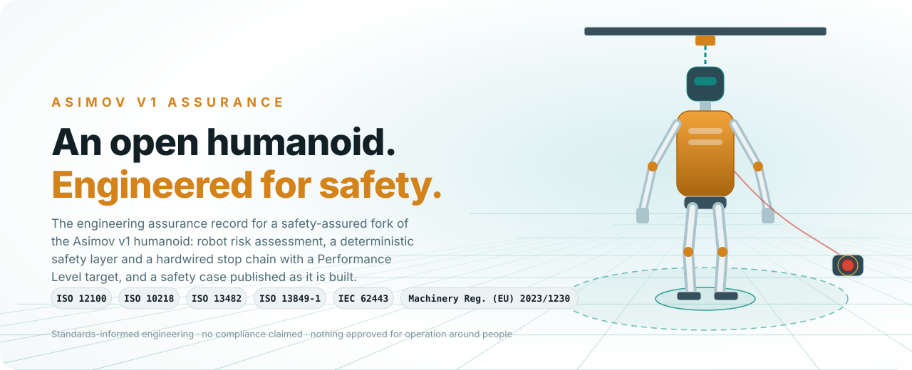
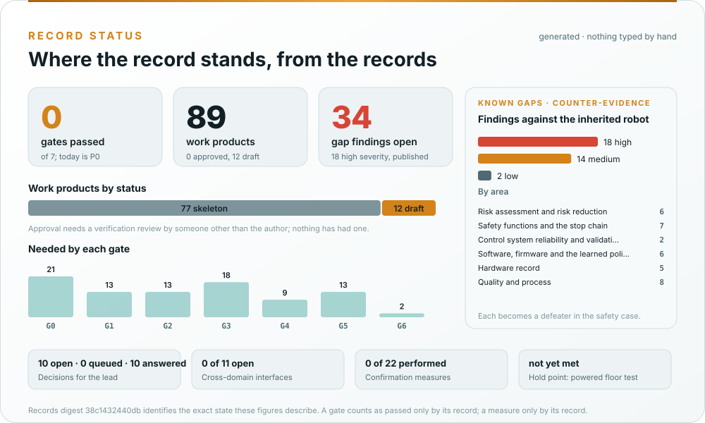
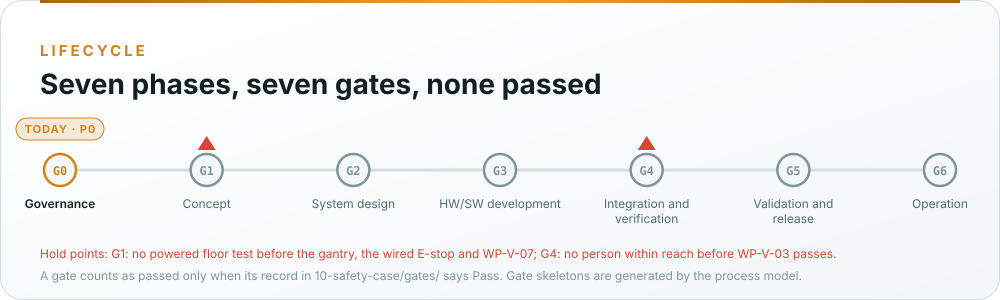
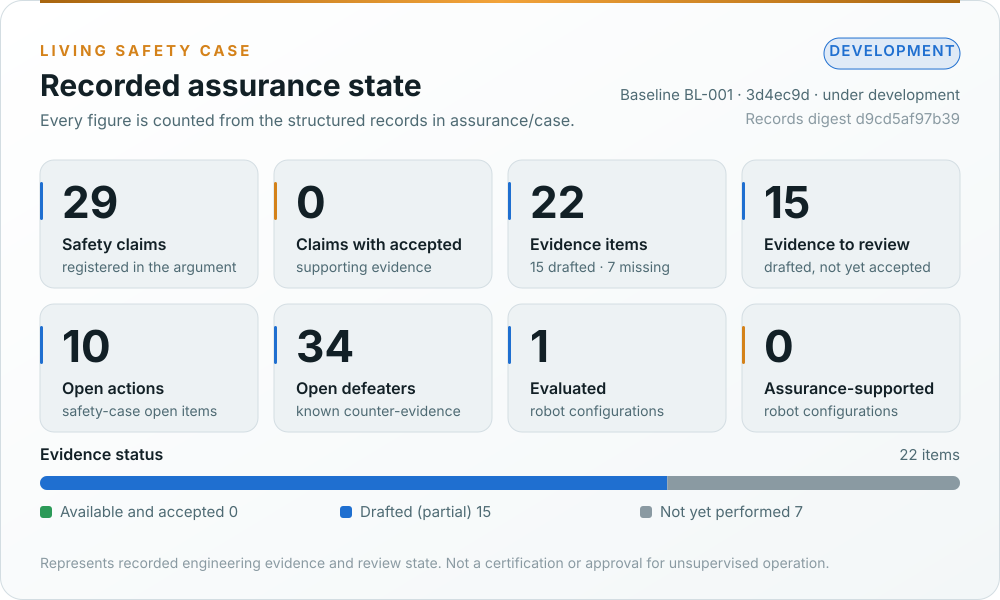
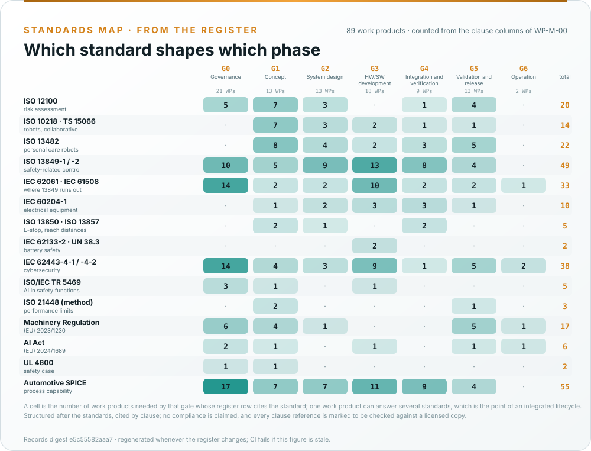

<p align="center">
  
</p>

> [!IMPORTANT]
> **This is a fork.** Everything above the [Safety-assurance record](#safety-assurance-record) heading is upstream's
> README, kept as published. Everything below it is the fork's safety-assurance record, which upstream
> (`asimovinc/asimov-v1`) neither produced nor endorses. **Asimov v1 is research hardware and the record is a draft
> prepared for engineering review:** no safety function reaches any Performance Level under ISO 13849-1 today, the
> robot is not CE-marked, and no configuration is approved for operation around people.

# Asimov v1: Open-Source Humanoid Robot

[](HARDWARE-LICENSE.txt)
[](SOFTWARE-LICENSE.txt)

Asimov is an open-source humanoid robot that you can build, train and customize.


<p align="center">
  <a href="https://asimov.inc">Website</a> ·
  <a href="https://manual.asimov.inc">Manual</a> ·
  <a href="https://asimov.inc/diy-kit">DIY Kit</a> ·
  <a href="https://static.asimov.inc/asimov/v1/asimov-v1-20260420.html">3D Model</a> ·
  <a href="https://discord.gg/HzDfGN7kUw">Discord</a> ·
  <a href="https://x.com/asimovinc">X</a> ·
  <a href="https://forum.menlo.ai">Forum</a>
</p>

Asimov v1 is a 1.2 m, 35 kg biped with 25 actuated degrees of freedom. This repository contains the mechanical CAD, electrical CAD, simulation model, and onboard software to build, simulate, and customize Asimov v1.

---

## Specifications

| Spec | Value |
|---|---|
| Height | 1.2 m |
| Weight | 35 kg |
| Degrees of Freedom | 25 actuated + 2 passive |
| Legs | 6 DOF x 2 + toe x 2 |
| Arms | 5 DOF x 2 (shoulder pitch/roll/yaw, elbow, wrist yaw) |
| Torso | 1 DOF waist yaw, 10 W 4 ohm speaker, 6 DOF IMU |
| Head | 2 DOF neck (neck yaw, neck pitch), Quad microphone array, 2MP monocular camera |
| CAN Bus | 5 @ 1Mbps + 1 @ 500kbps |
| Onboard Compute | Raspberry Pi 5 (media + network) + Radxa CM5 (motion control) |
| Structural Materials | 7075 aluminium, MJF PA12 nylon |

| Activity | Load |
|---|---|
| Squat | 5 kg |
| Bicep curl | 15 kg each arm |
| Lateral raise | 18 kg each arm |

---

## Build your own Asimov

> [!TIP]
> **Option 1: DIY Kit:** Everything you need to build Asimov v1, unassembled. $499 deposit to reserve. $15,000 target price. Ships summer 2026. [Pre-order →](https://asimov.inc/diy-kit)

> [!NOTE]
> **Option 2: Self-source:** Pull the [BOM](https://manual.asimov.inc/v1/bom) and fabricate everything yourself. [Assembly Manual →](https://manual.asimov.inc)

### DIY Kit

| Category | Included | Not Included |
|---|---|---|
| Hardware | All BOM components (unassembled), power supply & cabling, spare parts | Tools, hands |
| Compute | RPi edge board, motion control board, network board, power distribution board | 4G/5G modules |
| Sensors | Monocular camera, IMUs, mic, speaker, motor joint states | Lidar, 360 cam |
| Safety | Wireless E-Stop, safety guidelines | Battery |
| Docs | Quick start guide, manual, DIY build videos | — |

**[Pre-order the Asimov v1 DIY Kit →](https://asimov.inc/diy-kit)**

### Self-source

Pull the [BOM](https://manual.asimov.inc/v1/bom), source the parts, fabricate what needs fabricating.

**[Assembly Manual →](https://manual.asimov.inc)**

---

## Roadmap

| Status | Item |
|---|---|
| ✅ | Mechanical CAD — 7 subassemblies |
| ✅ | MuJoCo simulation model |
| ✅ | Electrical wiring harness |
| ✅ | Electrical schematics & PCB files |
| 🔜 | Asimov API |
| 🔜 | Locomotion policy |
| 🔜 | Mobile app |

---

## Work with us

- **Build questions?**: Ask in the [forum](https://forum.menlo.ai) or open a [GitHub Issue](https://github.com/asimovinc/asimov-v1/issues) for bugs and contributions.
- **Deploying Asimov?**: [Talk to us →](mailto:bd@menlo.ai)
- **Supply chain partner?**: If you manufacture actuators, structural components, or electronics and want to be part of the Asimov supply chain, reach out.
[bd@menlo.ai](mailto:bd@menlo.ai)


---

## Safety-assurance record

<p align="center">
  <b>The engineering assurance record for a safety-assured fork of the Asimov v1 bipedal humanoid: machinery and robot risk assessment, a deterministic safety layer and a hardwired stop chain with a Performance Level target, a tether while no fall-arrest function exists, cybersecurity and machine-learning safety, and a safety case published as it is built.</b>
</p>

<p align="center">
  <a href="docs/README.md">Documentation</a> &nbsp;·&nbsp;
  <a href="https://github.com/jherrodthomas/asimov-v1/wiki">Wiki</a> &nbsp;·&nbsp;
  <a href="#the-assurance-record">Record status</a> &nbsp;·&nbsp;
  <a href="#safety-architecture">Architecture</a> &nbsp;·&nbsp;
  <a href="#standards-and-engineering-framework">Standards</a> &nbsp;·&nbsp;
  <a href="#record-roadmap">Roadmap</a> &nbsp;·&nbsp;
  <a href="#known-gaps">Known gaps</a> &nbsp;·&nbsp;
  <a href="#getting-started-with-the-record">Getting started</a> &nbsp;·&nbsp;
  <a href="#contributing-to-the-record">Contributing</a>
</p>

<p align="center">
  <a href="https://github.com/jherrodthomas/asimov-v1/actions/workflows/assurance.yaml"></a>
  <a href="https://github.com/jherrodthomas/asimov-v1/actions/workflows/wiki.yaml"></a>
  <a href="assurance/01-management/decisions/README.md"></a>
  <a href="assurance/00-assessment/gap-assessment.md"></a>
  <a href="assurance/case/README.md"></a>
</p>

### Why this exists

Asimov v1 has a shape a safety argument can use: a tele-operation stack on a Raspberry Pi 5 in front of a motion
control board on a Radxa CM5 that is the last computer before the 25 actuators. What the published repository lacks is
the safety engineering: no risk assessment of its own, no documented emergency-stop architecture, no fuse table or
disconnect, no battery specification, no firmware in any public repository, and nothing that arrests the fall of a
35 kg body when power is removed. The fork keeps upstream's sources and adds the record around them, under the
standards that apply to a machine and to a robot that shares space with people. The fork's earlier concept-phase
package (five workbooks and three documents) is kept as the record's seed under
[`assurance/00-assessment/concept-package/`](assurance/00-assessment/concept-package/README.md).

### The assurance record

Every work product lives under [`assurance/`](assurance/README.md), numbered in lifecycle order, with a
document-control header that says what it is, which clauses it answers to, and whether anyone has reviewed it.
Nothing is marked complete before its review, and every number below is computed from the records by
[`make_assets.py`](docs/assets/asimov/make_assets.py) and checked by CI on every pull request.

<p align="center">
  
</p>

<!-- BEGIN GENERATED: record-headline (docs/assets/asimov/make_assets.py) -->

**P0 Governance** · no gate passed · 89 work products (12 draft, 77 skeleton, 0 approved) · 34 gap findings (18 high) · 10 decisions open · 2 of 11 cross-domain interfaces open · 0 of 22 confirmation measures performed · records digest `21e4132c8591`

<!-- END GENERATED: record-headline -->

<p align="center">
  
</p>

| What the card guarantees | |
|---|---|
| A gate counts as passed | only when its record in [`10-safety-case/gates/`](assurance/10-safety-case/gates/README.md) says Pass; a skeleton generated from the process model is not a record |
| A work product counts as approved | only after a verification review by someone other than its author ([WP-P-05](assurance/07-supporting/WP-P-05-verification-review-procedure.md)); a confirmation measure counts only by its record under [`confirmation/`](assurance/10-safety-case/confirmation/README.md) |
| The Living Safety Case dashboard | is generated from the records in [`assurance/case/`](assurance/case/README.md): claims, evidence with review state, defeaters, actions, configurations and reviews, with a validator that refuses an accepted claim whose evidence is not available and accepted or whose defeater is open |
| The records digest | identifies the exact state of the register, the gap assessment, the decision register, the process model and the gate and confirmation records these figures describe, so two readers can confirm they saw the same state |

The second generated layer is the Living Safety Case itself: the same claims, evidence and defeaters as records,
validated and drawn by [`generate_dashboard.py`](assurance/case/tools/generate_dashboard.py).

<p align="center">
  
</p>

<!-- BEGIN GENERATED: assurance-headline (assurance/case/tools/generate_dashboard.py) -->

**Development** · baseline `BL-001` at `3d4ec9d` · 29 claims (0 with accepted evidence) · 22 evidence items (0 accepted) · 34 open defeaters · records digest `d9cd5af97b39`

<!-- END GENERATED: assurance-headline -->

**Start here:** [assurance strategy (WP-M-01)](assurance/01-management/WP-M-01-assurance-strategy.md) · [safety plan (WP-M-02)](assurance/01-management/WP-M-02-safety-plan.md) · [process model and maps (WP-P-11)](assurance/process/README.md) · [test operations hold point (WP-V-07)](assurance/06-validation/WP-V-07-test-operations.md) · [decision register](assurance/01-management/decisions/README.md)

> **Assurance status represents recorded engineering evidence and review state. It does not constitute certification or approval for operation around people.**

### Safety architecture

<p align="center">
  
</p>

The argument is a doer-and-checker argument with one more step. The tele-operation stack and the locomotion policy
propose; the deterministic safety layer on the motion control board checks; and a hardwired stop chain is the checker
of last resort that nothing in software can override. A biped adds a question a wheeled machine never asks: removing
power drops the robot, so the safe state is a decision ([DQ-005](assurance/01-management/decisions/README.md)) and,
until a controlled-descent function exists, the tether and gantry of the laboratory carry the fall.

| Layer | Role | State |
|---|---|---|
| Tele-operation stack and locomotion policy | Operator commands over the Asimov API, WebRTC video; in future the learned policy's joint targets | Inherited; the policy, the API contract and the authentication scheme are unreleased or undocumented; hardening proposed |
| Deterministic safety layer (motion control board) | Clamps every joint command, checks the IMU, runs the watchdog, holds the mode machine, performs the controlled descent | **Does not exist in any public repository.** Specified in the [safety functions](assurance/02-concept/WP-C-04-safety-functions-and-plr.md); architecture in [WP-S-03](assurance/03-system/WP-S-03-technical-safety-concept.md) |
| Hardwired stop chain | Emergency stop, link surveillance, actuator power removal, BMS interlock | **Does not exist yet.** Bench version first ([WP-V-07](assurance/06-validation/WP-V-07-test-operations.md)), product version in the [SRP/CS architecture](assurance/03-system/WP-S-03-technical-safety-concept.md) |
| Tether and gantry | Carries the robot's mass in a fall while no fall-arrest function exists | A condition of every powered floor test; decision DQ-007 |
| Safety and assurance | Risk assessment, safety functions and PLr, PL calculation, validation, cybersecurity, safety case | Draft and skeleton work products, not yet reviewed |

More in the [architecture overview](docs/architecture.md) and [WP-M-01 §6](assurance/01-management/WP-M-01-assurance-strategy.md#6-safety-architecture-argument-the-central-strategy).

### Standards and engineering framework

<p align="center">
  
</p>

Asimov v1 is a machine and a robot that shares space with people, so the frame is the machinery set with the robot
standards, applied with one method: one hazard log, one requirements database, generated figures, a safety case with
its defeaters published. Work products are structured after these standards and cite their clauses; **no compliance is
claimed**, because no assessment has been performed.
[WP-M-01 §4](assurance/01-management/WP-M-01-assurance-strategy.md#4-the-standards-and-how-each-one-is-used)
explains how each standard is used and where it is tailored; the wiki's
[How we use each standard](https://github.com/jherrodthomas/asimov-v1/wiki/How-we-use-each-standard) is the
plain-language version.

| Topic | Standard | Main work products |
|---|---|---|
| Risk assessment and reduction | ISO 12100:2010 | [Item definition](assurance/02-concept/WP-C-01-item-definition.md) · [Risk assessment](assurance/02-concept/WP-C-03-risk-assessment.md) · [Risk reduction concept](assurance/02-concept/WP-C-05-risk-reduction-concept.md) |
| Industrial robots and collaborative operation | ISO 10218-1/-2:2025, ISO/TS 15066:2016 | [Safety functions and required PL](assurance/02-concept/WP-C-04-safety-functions-and-plr.md) · [Human-robot interaction and contact](assurance/02-concept/WP-C-06-human-robot-interaction-and-misuse.md) |
| Personal care robots (hazard catalogue, stability, verification) | ISO 13482:2014 | [Operating envelopes](assurance/02-concept/WP-C-02-operating-environment-and-tasks.md) · [Stability and fall tests](assurance/06-validation/WP-V-02-stopping-braking-stability-tests.md) |
| Safety-related parts of control systems | ISO 13849-1:2023, ISO 13849-2:2012 | [SRP/CS architecture](assurance/03-system/WP-S-03-technical-safety-concept.md) · [PL calculation](assurance/04-hardware/WP-H-04-reliability-data-and-pl-calculation.md) · [Safety validation](assurance/06-validation/WP-V-01-safety-validation.md) |
| Where ISO 13849 runs out | IEC 62061:2021, IEC 61508:2010 | [Software safety requirements](assurance/05-software/WP-W-02-software-safety-requirements.md) · [Confirmation measures](assurance/01-management/WP-M-06-confirmation-measures-plan.md) |
| Electrical equipment, emergency stop, battery | IEC 60204-1:2018, ISO 13850:2015, IEC 62133-2:2017 | [Electrical safety](assurance/04-hardware/WP-H-05-electrical-safety.md) · [Fall-arrest and stopping budget](assurance/03-system/WP-S-04-response-time-and-stopping-budget.md) |
| Cybersecurity | IEC 62443-4-1:2018, IEC 62443-4-2:2019 | [Threat and risk assessment](assurance/02-concept/WP-C-07-cybersecurity-threat-and-risk-assessment.md) · [Cybersecurity plan](assurance/01-management/WP-M-08-cybersecurity-plan.md) |
| Machine learning in safety functions | ISO/IEC TR 5469:2024 | [ML component definition](assurance/02-concept/WP-C-09-ml-component-definition-and-safety-requirements.md) · [ML safety plan](assurance/01-management/WP-M-09-ml-safety-plan.md) |
| Regulatory | Regulation (EU) 2023/1230 (Machinery), Regulation (EU) 2024/1689 (AI Act) | [Regulatory conformity strategy](assurance/01-management/WP-M-13-regulatory-conformity-strategy.md) |
| Safety case structure | UL 4600 principles | [Safety case](assurance/10-safety-case/WP-K-01-safety-case.md) |

<p align="center">
  
</p>

| Supporting practice | Where it is applied |
|---|---|
| Integrated process model | [WP-P-11](assurance/process/README.md): activities, lanes, cross-domain interfaces and gates as data; generated swimlane maps and gate skeletons |
| Process capability | [ASPICE self-assessment, WP-M-12](assurance/01-management/WP-M-12-process-capability-baseline.md) |
| Performance limits of perception and the policy | ISO 21448 used as a method, not a standard, in the [insufficiency analysis](assurance/02-concept/WP-C-10-functional-insufficiency-analysis.md) |
| Safety analysis | [FMEA](assurance/08-analyses/WP-A-01-system-fmea.md) · [FTA](assurance/08-analyses/WP-A-02-fault-tree-analysis.md) · [CCF](assurance/08-analyses/WP-A-03-common-cause-failure-analysis.md) · [STPA](assurance/08-analyses/WP-A-04-stpa.md) · [Independence of the chain](assurance/08-analyses/WP-A-05-independence-of-the-safety-chain.md) |
| Independent review | [Confirmation measures plan](assurance/01-management/WP-M-06-confirmation-measures-plan.md) · [Verification and review procedure](assurance/07-supporting/WP-P-05-verification-review-procedure.md) |
| Decisions | [Decision register](assurance/01-management/decisions/README.md): every question for the project lead, self-contained, in batches of ten |

### Record roadmap

<p align="center">
  
</p>

Status is taken from what exists in the repository. "Draft" means written but not reviewed; "skeleton" means the
structure and clause map exist and the content is still to be written.

| Phase | Work | Status |
|---|---|---|
| **1 · Foundation** | [Assurance strategy](assurance/01-management/WP-M-01-assurance-strategy.md), [safety plan](assurance/01-management/WP-M-02-safety-plan.md), [confirmation measures](assurance/01-management/WP-M-06-confirmation-measures-plan.md), [regulatory strategy](assurance/01-management/WP-M-13-regulatory-conformity-strategy.md) | Draft |
| | [Baseline gap assessment](assurance/00-assessment/gap-assessment.md) | Draft |
| | [Work product register](assurance/01-management/WP-M-00-work-product-register.md), [process model and maps](assurance/process/README.md), [decision register](assurance/01-management/decisions/README.md) | Draft; checked by CI |
| | [Living Safety Case records and dashboard](assurance/case/README.md) | Draft: records at BL-001, validated and drawn by CI |
| **2 · Safety engineering** | [Item definition](assurance/02-concept/WP-C-01-item-definition.md), [operating envelopes](assurance/02-concept/WP-C-02-operating-environment-and-tasks.md), [risk assessment](assurance/02-concept/WP-C-03-risk-assessment.md), [safety functions and PLr](assurance/02-concept/WP-C-04-safety-functions-and-plr.md) | Draft, ported from the concept package; PLr and envelope pending the lead (DQ-002, DQ-004) |
| | [Insufficiency analysis](assurance/02-concept/WP-C-10-functional-insufficiency-analysis.md), [cybersecurity threat assessment](assurance/02-concept/WP-C-07-cybersecurity-threat-and-risk-assessment.md), [ML component definition](assurance/02-concept/WP-C-09-ml-component-definition-and-safety-requirements.md) | Skeleton |
| | [Test operations hold point](assurance/06-validation/WP-V-07-test-operations.md) | Draft; the gantry, the wired E-stop and the bench supply wait on the lead (DQ-007, DQ-008, DQ-009) |
| **3 · Build and verify** | Bench equipment, the [safety layer](assurance/05-software/WP-W-03-software-architecture.md), [chain architecture](assurance/03-system/WP-S-03-technical-safety-concept.md) and [PL calculation](assurance/04-hardware/WP-H-04-reliability-data-and-pl-calculation.md), [fall and descent tests](assurance/06-validation/WP-V-02-stopping-braking-stability-tests.md), [fault injection](assurance/06-validation/WP-V-05-fault-injection.md) | Planned |
| **4 · Validate and release** | [Safety validation](assurance/06-validation/WP-V-01-safety-validation.md), [assessment](assurance/10-safety-case/WP-K-04-functional-safety-assessment.md), [technical documentation](assurance/10-safety-case/WP-K-02-technical-documentation-index.md), [release record](assurance/10-safety-case/WP-K-06-release-record.md), [field monitoring](assurance/09-production-operation/WP-O-04-field-monitoring.md) | Planned |

### Known gaps

The project publishes its own counter-evidence. The [baseline gap assessment](assurance/00-assessment/gap-assessment.md)
reviewed the inherited repository and the concept-phase package, finding by finding, against the standards above. The
findings that shape everything:

| | Finding | Closes through |
|---|---|---|
| GAP-03, GAP-10 | Nothing bounds the fall of the 35 kg body, and the safe state on E-stop or heartbeat loss is to drop the robot | The safe-state decision (DQ-005); the tether and gantry before any floor test ([WP-V-07](assurance/06-validation/WP-V-07-test-operations.md)); controlled descent SF-02 ([WP-C-04](assurance/02-concept/WP-C-04-safety-functions-and-plr.md)); the [fall-arrest budget](assurance/03-system/WP-S-04-response-time-and-stopping-budget.md) |
| GAP-07, GAP-11 | The emergency-stop architecture is undocumented and the wireless link has no surveillance | A wired dual-channel pendant for the bench (DQ-008); the hardwired chain ([WP-S-03](assurance/03-system/WP-S-03-technical-safety-concept.md)); link surveillance SF-13 |
| GAP-05, GAP-06 | No contact limit and no joint torque, speed or momentum limit is declared | The clamps SF-03 and the measured limits of [WP-V-03](assurance/06-validation/WP-V-03-personnel-detection-validation.md); nobody within reach until then |
| GAP-13, GAP-17 | Balance is allocated to an unreleased learned policy with no independent safeguard | The allocation decision (DQ-006); [WP-C-09](assurance/02-concept/WP-C-09-ml-component-definition-and-safety-requirements.md) and the [independence analysis](assurance/08-analyses/WP-A-05-independence-of-the-safety-chain.md) |
| GAP-08, GAP-12 | No power distribution, fuse table, disconnect or battery specification; the battery is user-supplied with no BMS interlock | [Electrical safety](assurance/04-hardware/WP-H-05-electrical-safety.md); the battery policy (DQ-009); a bench supply until then |
| GAP-16, GAP-14 | No firmware in any public repository and no reliability figure for any component | The safety layer as a fork work product ([WP-W-02](assurance/05-software/WP-W-02-software-safety-requirements.md)); component data from upstream or substitution ([WP-H-04](assurance/04-hardware/WP-H-04-reliability-data-and-pl-calculation.md)) |
| GAP-19, GAP-20 | The tele-operation authentication is undocumented; the E-stop link and the debug port are unprotected | Cybersecurity requirements and architecture ([WP-C-08](assurance/02-concept/WP-C-08-cybersecurity-requirements-and-sl-target.md), [WP-S-07](assurance/03-system/WP-S-07-cybersecurity-architecture.md)) |

Every finding becomes a defeater against a claim in the safety case and stays open until the work product that
closes it is reviewed.

### Getting started with the record

The robot's sources are upstream's and are documented above and in the [manual](https://manual.asimov.inc). The
record needs only Python 3 (PyYAML for the decision register):

```bash
git clone https://github.com/jherrodthomas/asimov-v1.git
cd asimov-v1
python3 assurance/case/tools/validate.py                         # the Living Safety Case records
python3 assurance/01-management/decisions/check_decisions.py     # the questions for the lead
python3 assurance/process/tools/process_model.py --check         # process maps and gate skeletons current
python3 assurance/tools/folder_index.py --check                  # folder indexes match the register
python3 docs/assets/asimov/make_assets.py --check                # README figures match their generator
python3 tools/wiki/build_wiki.py                                 # the wiki pages check clean
```

**On a robot:** the fork publishes no firmware and no release build. No Asimov v1 unit is powered with its feet on
the floor under the fork's control until the conditions of [WP-V-07](assurance/06-validation/WP-V-07-test-operations.md)
hold: a rated gantry and tether, a wired dual-channel emergency stop through contactors, a bench supply in place of a
battery, known joint limits, an identified controller build and a marked test area with nobody in it.

### Contributing to the record

Contributions are welcome in machinery and robot safety, safety-related control systems, electrical and mechanical
engineering, firmware, legged locomotion, cybersecurity, verification, documentation and review. Safety-relevant
changes need a rationale, an impact analysis and appropriate verification.

| | |
|---|---|
| [Contributing](CONTRIBUTING.md) | Rules for safety-relevant changes and assurance records |
| [Issues](https://github.com/jherrodthomas/asimov-v1/issues) · [Pull requests](https://github.com/jherrodthomas/asimov-v1/pulls) | Problem reports, safety concerns, reviews of the analyses; pull requests target `main` |
| [Security policy](SECURITY.md) | Private vulnerability reporting |
| [Wiki](https://github.com/jherrodthomas/asimov-v1/wiki) | Orientation: processes, process maps, how each standard is used, glossary, how decisions are made. Kept in [`wiki/`](wiki/README.md) and mirrored on merge |
| [Upstream Asimov v1](https://github.com/asimovinc/asimov-v1) | The robot this fork is derived from |

### Maintainer and upstream attribution

**Jherrod Thomas** maintains this record as an open engineering initiative: a public demonstration of
safety-lifecycle development, systems engineering and assurance practice on a real humanoid platform.

Asimov v1 is published by Asimov Inc. under CERN-OHL-S-2.0 ([hardware](HARDWARE-LICENSE.txt)) and GPL-2.0
([software](SOFTWARE-LICENSE.txt)). The record under `assurance/`, `docs/`, `tools/` and `wiki/` is a derivative
analytical work of those sources and is released under the same licences. The fork is an independent project, is not
affiliated with or endorsed by Asimov Inc., and carries no Asimov trademark claim.

Open-source licensing does not establish machinery safety certification, CE marking, or suitability for operation
around people.
