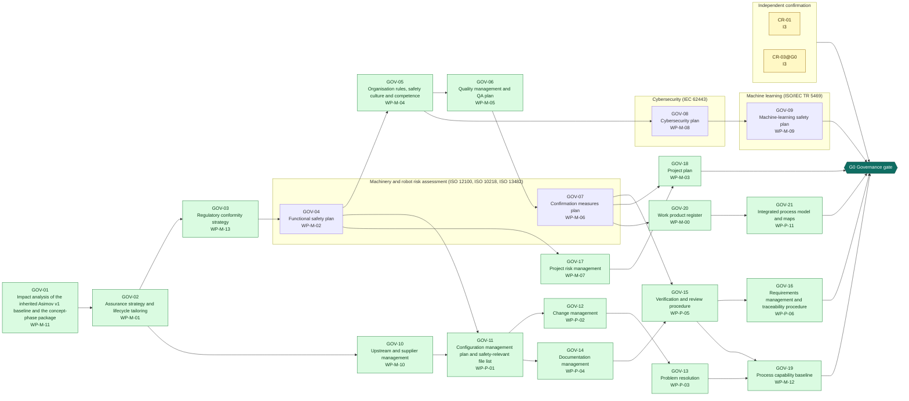

<!-- GENERATED by assurance/process/tools/process_model.py from assurance/process/model/. Do not edit; edit the model and re-run. -->

# G0 Governance: integrated process map (L1)

Back to the [lifecycle map](lifecycle.md). Model: [`model/`](../model/), method: [process README](../README.md).

## 1. Swimlane map

One box per discipline; green activities are joint work of all disciplines and sit outside the boxes. Arrows are work-product inputs: an activity cannot finish before its inputs exist. An arrow implied by a longer path is left out; §2 lists every input. Iteration between disciplines is shown in the interface map (§1.1), not here.

### 1.1 Interface map

Where one discipline's analysis depends on another's. Each edge lists the interfaces of §3 between two lanes; OPEN marks one that a recorded open item still has to settle.

## 2. Activities

Clause references and status are read from the [register (WP-M-00)](../../01-management/WP-M-00-work-product-register.md) row of each work product the activity produces or, for a living work product, updates (marked *update*).

| Activity | Lane | Produces | Inputs | Machinery | SRP/CS | IEC 62443 | Other | ASPICE | Status |
|---|---|---|---|---|---|---|---|---|---|
| GOV-01 Impact analysis of the inherited Asimov v1 baseline and the concept-phase package | Joint (all disciplines) | [WP-M-11](../../01-management/WP-M-11-impact-analysis.md) |  | 12100 §4 | 61508-1 §7.16 (modification) | 62443-4-1 SM-3 | Machinery Reg. Art. 3 (substantial modification) | SUP.10 | Skeleton |
| GOV-02 Assurance strategy and lifecycle tailoring | Joint (all disciplines) | [WP-M-01](../../01-management/WP-M-01-assurance-strategy.md) | WP-M-11 | 12100 §4 | 13849-1 §4; 61508-1 §6 | 62443-4-1 SM-1 | TR 5469 (AI lifecycle), UL 4600 (safety case), Machinery Reg. Art. 25 | MAN.3 | Draft |
| GOV-03 Regulatory conformity strategy | Joint (all disciplines) | [WP-M-13](../../01-management/WP-M-13-regulatory-conformity-strategy.md) | WP-M-01 |  |  |  | Machinery Reg. Art. 25, Annex I, Annexes VI–X; AI Act Art. 6, Art. 43, Annex I |  | Draft |
| GOV-04 Functional safety plan | Machinery and robot risk assessment (ISO 12100, ISO 10218, ISO 13482) | [WP-M-02](../../01-management/WP-M-02-safety-plan.md) | WP-M-01, WP-M-13 | 12100 §4 | 13849-1 §4; 62061 §5; 61508-1 §6 |  |  | MAN.3 | Draft |
| GOV-05 Organisation rules, safety culture and competence | Joint (all disciplines) | [WP-M-04](../../01-management/WP-M-04-organization-competence-safety-culture.md) | WP-M-02 |  | 61508-1 §6.2 (competence); 13849-1 §4 | 62443-4-1 SM-4 |  |  | Skeleton |
| GOV-06 Quality management and QA plan | Joint (all disciplines) | [WP-M-05](../../01-management/WP-M-05-quality-assurance-plan.md) | WP-M-02, WP-M-04 |  | 61508-1 §6.2 | 62443-4-1 SM-5 | ISO 9001 §7.5, §8.3, §8.7, §10.2 (informative) | SUP.1 | Skeleton |
| GOV-07 Confirmation measures plan | Machinery and robot risk assessment (ISO 12100, ISO 10218, ISO 13482) | [WP-M-06](../../01-management/WP-M-06-confirmation-measures-plan.md) | WP-M-01, WP-M-02, WP-M-05, WP-M-13 |  | 13849-1 §8, §10; 61508-1 §8 | 62443-4-1 SM-13 | Machinery Reg. Art. 25, Annexes VI–X |  | Draft |
| GOV-08 Cybersecurity plan | Cybersecurity (IEC 62443) | [WP-M-08](../../01-management/WP-M-08-cybersecurity-plan.md) | WP-M-01, WP-M-04, WP-M-11 |  |  | 62443-4-1 §5 (SM-1…SM-13); 62443-4-2 §4 |  | MAN.7 (CS) | Skeleton |
| GOV-09 Machine-learning safety plan | Machine learning (ISO/IEC TR 5469) | [WP-M-09](../../01-management/WP-M-09-ml-safety-plan.md) | WP-M-01, WP-M-08, WP-M-11, WP-M-13 |  |  |  | TR 5469 (AI technology classes, usage levels); AI Act Art. 9 | MLE.1–4 | Skeleton |
| GOV-10 Upstream and supplier management | Joint (all disciplines) | [WP-M-10](../../01-management/WP-M-10-upstream-and-supplier-management.md) | WP-M-01, WP-M-11 |  | 61508-1 §6.2 (subcontracted activities) | 62443-4-1 SM-9, SM-10 |  | ACQ.4 | Skeleton |
| GOV-11 Configuration management plan and safety-relevant file list | Joint (all disciplines) | [WP-P-01](../../07-supporting/WP-P-01-configuration-management-plan.md) | WP-M-02, WP-M-10 |  | 61508-1 §6.2.3; 13849-1 §12 | 62443-4-1 SM-6, SM-7 |  | SUP.8 | Skeleton |
| GOV-12 Change management | Joint (all disciplines) | [WP-P-02](../../07-supporting/WP-P-02-change-management.md) | WP-P-01, WP-M-11 |  | 61508-1 §7.16 | 62443-4-1 SM-3 |  | SUP.10 | Skeleton |
| GOV-13 Problem resolution | Joint (all disciplines) | [WP-P-03](../../07-supporting/WP-P-03-problem-resolution.md) | WP-M-02, WP-P-02 |  | 61508-1 §6.2 (anomaly handling) | 62443-4-1 DM-1…DM-6 |  | SUP.9 | Skeleton |
| GOV-14 Documentation management | Joint (all disciplines) | [WP-P-04](../../07-supporting/WP-P-04-documentation-management.md) | WP-M-13, WP-P-01 | 12100 §7 | 13849-1 §12 | 62443-4-1 SG-1 | Machinery Reg. Annex IV | SUP.7 | Skeleton |
| GOV-15 Verification and review procedure | Joint (all disciplines) | [WP-P-05](../../07-supporting/WP-P-05-verification-review-procedure.md) | WP-M-06, WP-P-04 |  | 13849-1 §8; 61508-1 §7.18 | 62443-4-1 SVV-1 |  | SUP.2 | Skeleton |
| GOV-16 Requirements management and traceability procedure | Joint (all disciplines) | [WP-P-06](../../07-supporting/WP-P-06-requirements-management-traceability.md) | WP-P-04, WP-P-05 |  | 13849-1 §5; 61508-3 §7.2 | 62443-4-1 SR-5 |  | SYS.2, SWE.1 | Skeleton |
| GOV-17 Project risk management | Joint (all disciplines) | [WP-M-07](../../01-management/WP-M-07-risk-management.md) | WP-M-01, WP-M-02 |  |  |  |  | MAN.5 | Skeleton |
| GOV-18 Project plan | Joint (all disciplines) | [WP-M-03](../../01-management/WP-M-03-project-plan.md) | WP-M-02, WP-M-06, WP-M-07 |  |  |  |  | MAN.3 | Skeleton |
| GOV-19 Process capability baseline | Joint (all disciplines) | [WP-M-12](../../01-management/WP-M-12-process-capability-baseline.md) | WP-M-02, WP-P-01, WP-P-02, WP-P-03, WP-P-05 |  |  |  |  | All in scope | Skeleton |
| GOV-20 Work product register | Joint (all disciplines) | [WP-M-00](../../01-management/WP-M-00-work-product-register.md) | WP-M-01, WP-M-02, WP-M-06, WP-M-13 |  | 13849-1 §4; 62061 §5 |  | Machinery Reg. Annex IV (index) | MAN.3 | Draft |
| GOV-21 Integrated process model and maps | Joint (all disciplines) | [WP-P-11](../../process/README.md) | WP-M-00, WP-M-02, WP-M-06 | 12100 §4 | 13849-1 §4; 61508-1 §6 | 62443-4-1 SM-1 | TR 5469 (AI lifecycle) | MAN.3 | Draft |

## 3. Cross-domain interfaces

Each interface is anchored to text in the work products; the checker fails if an anchor disappears. *Documented* means the documents reference each other but nobody has reviewed the agreement yet.

| ID | Pattern | Between | Topic | Status | Open item | Due |
|---|---|---|---|---|---|---|
| — | — | — | No interface recorded in this phase | — | — | — |

## 4. Clause coverage by standard

Which activity answers each clause reference listed in the register. One activity can answer several standards; that is the point of the integrated lifecycle.

- **Machinery:** 12100 §4 → GOV-01, GOV-02, GOV-04, GOV-21; 12100 §7 → GOV-14
- **SRP/CS:** 61508-1 §7.16 (modification) → GOV-01; 13849-1 §4; 61508-1 §6 → GOV-02, GOV-21; 13849-1 §4; 62061 §5; 61508-1 §6 → GOV-04; 61508-1 §6.2 (competence); 13849-1 §4 → GOV-05; 61508-1 §6.2 → GOV-06; 13849-1 §8, §10; 61508-1 §8 → GOV-07; 61508-1 §6.2 (subcontracted activities) → GOV-10; 61508-1 §6.2.3; 13849-1 §12 → GOV-11; 61508-1 §7.16 → GOV-12; 61508-1 §6.2 (anomaly handling) → GOV-13; 13849-1 §12 → GOV-14; 13849-1 §8; 61508-1 §7.18 → GOV-15; 13849-1 §5; 61508-3 §7.2 → GOV-16; 13849-1 §4; 62061 §5 → GOV-20
- **IEC 62443:** 62443-4-1 SM-3 → GOV-01, GOV-12; 62443-4-1 SM-1 → GOV-02, GOV-21; 62443-4-1 SM-4 → GOV-05; 62443-4-1 SM-5 → GOV-06; 62443-4-1 SM-13 → GOV-07; 62443-4-1 §5 (SM-1…SM-13); 62443-4-2 §4 → GOV-08; 62443-4-1 SM-9, SM-10 → GOV-10; 62443-4-1 SM-6, SM-7 → GOV-11; 62443-4-1 DM-1…DM-6 → GOV-13; 62443-4-1 SG-1 → GOV-14; 62443-4-1 SVV-1 → GOV-15; 62443-4-1 SR-5 → GOV-16
- **Other:** Machinery Reg. Art. 3 (substantial modification) → GOV-01; TR 5469 (AI lifecycle), UL 4600 (safety case), Machinery Reg. Art. 25 → GOV-02; Machinery Reg. Art. 25, Annex I, Annexes VI–X; AI Act Art. 6, Art. 43, Annex I → GOV-03; ISO 9001 §7.5, §8.3, §8.7, §10.2 (informative) → GOV-06; Machinery Reg. Art. 25, Annexes VI–X → GOV-07; TR 5469 (AI technology classes, usage levels); AI Act Art. 9 → GOV-09; Machinery Reg. Annex IV → GOV-14; Machinery Reg. Annex IV (index) → GOV-20; TR 5469 (AI lifecycle) → GOV-21
- **ASPICE:** SUP.10 → GOV-01, GOV-12; MAN.3 → GOV-02, GOV-04, GOV-18, GOV-20, GOV-21; SUP.1 → GOV-06; MAN.7 (CS) → GOV-08; MLE.1–4 → GOV-09; ACQ.4 → GOV-10; SUP.8 → GOV-11; SUP.9 → GOV-13; SUP.7 → GOV-14; SUP.2 → GOV-15; SYS.2, SWE.1 → GOV-16; MAN.5 → GOV-17; All in scope → GOV-19

## 5. G0 readiness

**Exit criterion (WP-M-00 §2):** Plans approved; roles assigned; configuration and change control running

**Work products:** 6 Draft, 15 Skeleton of 21. Approval needs the verification review of [WP-P-05](../../07-supporting/WP-P-05-verification-review-procedure.md).

**Roles the lanes need (WP-M-02 §3.1):**

| Lane | Role | Assigned to | Needed by |
|---|---|---|---|
| Joint (all disciplines) | Safety manager | Jherrod Thomas (acting) | G0 |
| Machinery and robot risk assessment (ISO 12100, ISO 10218, ISO 13482) | Safety manager | Jherrod Thomas (acting) | G0 |
| Cybersecurity (IEC 62443) | Cybersecurity manager | Jherrod Thomas (acting); permanent holder TBD | G1 |
| Machine learning (ISO/IEC TR 5469) | ML safety lead | Jherrod Thomas (acting); permanent holder TBD | G1 |
| Independent confirmation | External functional safety assessor | None for now (DQ-010 A, decided 2026-10-21): every I2 and I3 measure unscheduled; revisit at G1 | G1 (revisit) |

**Other roles WP-M-02 §3.1 needs by G0:** Project maintainer (Jherrod Thomas); Configuration and change manager (Jherrod Thomas (acting)); Verification reviewer(s) (TBD; a public call for one reviewer with machinery-safety or robotics experience is open in CONTRIBUTING.md (DQ-029 A, decided 2026-10-21), starting with WP-C-03 and WP-C-04); Quality assurance (TBD (independent of the author)).

**Role records that disagree** (the readiness tables read WP-M-02 §3.1; a discipline plan records the same role differently): none.

**Confirmation measures (WP-M-06 §9):**

| Measure | Covers | Independence | Record |
|---|---|---|---|
| CR-01 Confirmation review of the impact analysis | WP-M-11 | I3 | Not performed |
| CR-03@G0 Confirmation review of the safety plan and tailoring | WP-M-02, WP-M-01, WP-M-06 | I3 | Not performed |

**Work products with no confirmation measure at this gate** (verification review only): WP-M-13, WP-M-04, WP-M-05, WP-M-08, WP-M-09, WP-M-10, WP-P-01, WP-P-02, WP-P-03, WP-P-04, WP-P-05, WP-P-06, WP-M-07, WP-M-03, WP-M-12, WP-M-00, WP-P-11.

**Open interfaces due by this gate** (from this or an earlier phase): none.
