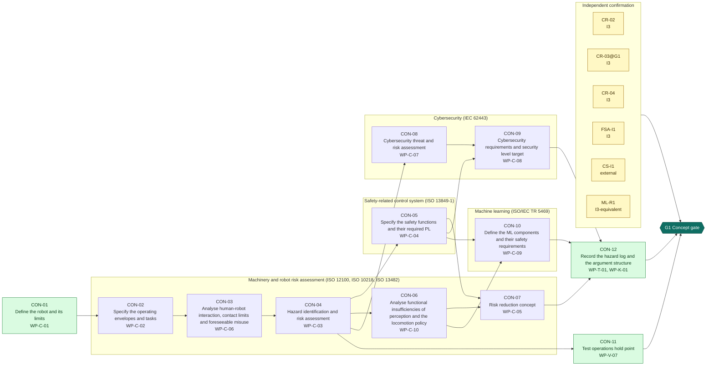
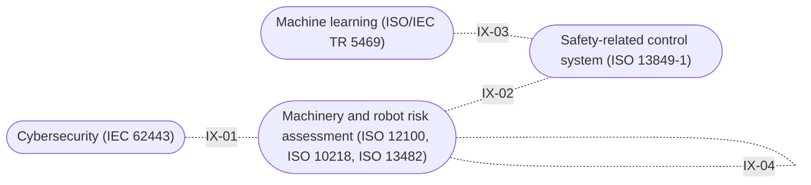

<!-- GENERATED by assurance/process/tools/process_model.py from assurance/process/model/. Do not edit; edit the model and re-run. -->

# G1 Concept: integrated process map (L1)

Back to the [lifecycle map](lifecycle.md). Model: [`model/`](../model/), method: [process README](../README.md).

## 1. Swimlane map

One box per discipline; green activities are joint work of all disciplines and sit outside the boxes. Arrows are work-product inputs: an activity cannot finish before its inputs exist. An arrow implied by a longer path is left out; §2 lists every input. Iteration between disciplines is shown in the interface map (§1.1), not here.

### 1.1 Interface map

Where one discipline's analysis depends on another's. Each edge lists the interfaces of §3 between two lanes; OPEN marks one that a recorded open item still has to settle.

## 2. Activities

Clause references and status are read from the [register (WP-M-00)](../../01-management/WP-M-00-work-product-register.md) row of each work product the activity produces or, for a living work product, updates (marked *update*).

| Activity | Lane | Produces | Inputs | Machinery | SRP/CS | IEC 62443 | Other | ASPICE | Status |
|---|---|---|---|---|---|---|---|---|---|
| CON-01 Define the robot and its limits | Joint (all disciplines) | [WP-C-01](../../02-concept/WP-C-01-item-definition.md) | WP-M-01, WP-M-11 | 12100 §5.3; 10218-1 §3, §5; 13482 §4 | 13849-1 §5 (inputs) | 62443-4-1 SR-1 | Machinery Reg. Annex III §1.1.2 | SYS.1 | Draft |
| CON-02 Specify the operating envelopes and tasks | Machinery and robot risk assessment (ISO 12100, ISO 10218, ISO 13482) | [WP-C-02](../../02-concept/WP-C-02-operating-environment-and-tasks.md) | WP-C-01 | 12100 §5.3; 13482 §5.2; 10218-2 §5 |  |  | ISO 21448 §5 (informative method) | SYS.1 | Draft |
| CON-03 Analyse human-robot interaction, contact limits and foreseeable misuse | Machinery and robot risk assessment (ISO 12100, ISO 10218, ISO 13482) | [WP-C-06](../../02-concept/WP-C-06-human-robot-interaction-and-misuse.md) | WP-C-01, WP-C-02 | 10218-2 §5; TS 15066 §5; 13482 §5.7, §5.8; 12100 §5.3 |  |  | ISO 13857 §4 |  | Skeleton |
| CON-04 Hazard identification and risk assessment | Machinery and robot risk assessment (ISO 12100, ISO 10218, ISO 13482) | [WP-C-03](../../02-concept/WP-C-03-risk-assessment.md) | WP-C-01, WP-C-02, WP-C-06 | 12100 §5.4–§5.6, Annex B; 13482 Annex A; 10218-1 Annex A | 13849-1 Annex A (risk graph inputs) |  | Machinery Reg. Annex III §1 |  | Draft |
| CON-05 Specify the safety functions and their required PL | Safety-related control system (ISO 13849-1) | [WP-C-04](../../02-concept/WP-C-04-safety-functions-and-plr.md) | WP-C-03, WP-C-06 | 10218-1 §5.4, §5.5; 13482 §5.16, §6; 13850 §4 | 13849-1 §5, Annex A (PLr) |  | 60204-1 §9.2 (stop categories) | SYS.2 | Draft |
| CON-06 Analyse functional insufficiencies of perception and the locomotion policy | Machinery and robot risk assessment (ISO 12100, ISO 10218, ISO 13482) | [WP-C-10](../../02-concept/WP-C-10-functional-insufficiency-analysis.md) | WP-C-02, WP-C-03 | 13482 §5.6, §5.10; 12100 §5.4 |  |  | ISO 21448 §6–§7 (informative method) |  | Skeleton |
| CON-07 Risk reduction concept | Machinery and robot risk assessment (ISO 12100, ISO 10218, ISO 13482) | [WP-C-05](../../02-concept/WP-C-05-risk-reduction-concept.md) | WP-C-03, WP-C-04, WP-C-10 | 12100 §6; 13482 §6; 10218-1 §5 | 13849-1 §5 |  | Machinery Reg. Annex III §1.1.2 | SYS.2 | Skeleton |
| CON-08 Cybersecurity threat and risk assessment | Cybersecurity (IEC 62443) | [WP-C-07](../../02-concept/WP-C-07-cybersecurity-threat-and-risk-assessment.md) | WP-C-01, WP-C-03 |  |  | 62443-4-1 SR-2; 62443-3-2 §5 |  | SEC.1 | Skeleton |
| CON-09 Cybersecurity requirements and security level target | Cybersecurity (IEC 62443) | [WP-C-08](../../02-concept/WP-C-08-cybersecurity-requirements-and-sl-target.md) | WP-C-04, WP-C-07 |  |  | 62443-4-1 SR-3…SR-5; 62443-4-2 CR 1–7, SL-T |  | SEC.1 | Skeleton |
| CON-10 Define the ML components and their safety requirements | Machine learning (ISO/IEC TR 5469) | [WP-C-09](../../02-concept/WP-C-09-ml-component-definition-and-safety-requirements.md) | WP-C-04, WP-C-10 |  |  |  | TR 5469 §6–§8 (classes, usage levels, properties); AI Act Annex IV | MLE.1 | Skeleton |
| CON-11 Test operations hold point | Joint (all disciplines) | [WP-V-07](../../06-validation/WP-V-07-test-operations.md) | WP-C-01, WP-C-02, WP-C-03 | 12100 §6.4; 13482 §7; 10218-2 §5 |  |  |  | VAL.1 | Draft |
| CON-12 Record the hazard log and the argument structure | Joint (all disciplines) | [WP-T-01](../../trace/README.md), [WP-K-01](../../10-safety-case/WP-K-01-safety-case.md) | WP-C-03, WP-C-04, WP-C-05, WP-C-08, WP-C-09 |  | 13849-1 §5; 61508-3 §7.2; 61508-1 §8 (assessment input) | 62443-4-1 SR-5 | UL 4600; Machinery Reg. Annex IV | consistency evidence (SYS.2–5, SWE.1–6) | Draft, Skeleton |

## 3. Cross-domain interfaces

Each interface is anchored to text in the work products; the checker fails if an anchor disappears. *Documented* means the documents reference each other but nobody has reviewed the agreement yet.

| ID | Pattern | Between | Topic | Status | Open item | Due |
|---|---|---|---|---|---|---|
| IX-01 | Safety-Security | [WP-C-03](../../02-concept/WP-C-03-risk-assessment.md), [WP-C-07](../../02-concept/WP-C-07-cybersecurity-threat-and-risk-assessment.md) (Machinery and robot risk assessment / Cybersecurity) | Threat scenarios that can cause a hazard are rated against the hazard list; cyber-induced hazards appear in the risk assessment | Documented | — | G1 |
| IX-02 | Safety-Performance limits | [WP-C-04](../../02-concept/WP-C-04-safety-functions-and-plr.md), [WP-C-10](../../02-concept/WP-C-10-functional-insufficiency-analysis.md) (Safety-related control system / Machinery and robot risk assessment) | The fall-arrest function SF-02 and the speed-reduction function SF-06 have a PLr but their claims are bounded by what the IMU and the camera can detect and by the safe state the biped can reach | Documented | — | G1 |
| IX-03 | Safety-ML | [WP-C-04](../../02-concept/WP-C-04-safety-functions-and-plr.md), [WP-C-09](../../02-concept/WP-C-09-ml-component-definition-and-safety-requirements.md) (Safety-related control system / Machine learning) | Whether the learned locomotion policy may carry the bipedal stability function SF-01, or stability in OE-1 rests on the tether and gantry with the policy as a functional component | Documented | — | G1 |
| IX-04 | Environment-Interaction | [WP-C-02](../../02-concept/WP-C-02-operating-environment-and-tasks.md), [WP-C-06](../../02-concept/WP-C-06-human-robot-interaction-and-misuse.md) (Machinery and robot risk assessment / Machinery and robot risk assessment) | People presence per operating envelope drives the interaction scenarios, the contact limits that apply and the misuse analysis | Documented | — | G1 |

## 4. Clause coverage by standard

Which activity answers each clause reference listed in the register. One activity can answer several standards; that is the point of the integrated lifecycle.

- **Machinery:** 12100 §5.3; 10218-1 §3, §5; 13482 §4 → CON-01; 12100 §5.3; 13482 §5.2; 10218-2 §5 → CON-02; 10218-2 §5; TS 15066 §5; 13482 §5.7, §5.8; 12100 §5.3 → CON-03; 12100 §5.4–§5.6, Annex B; 13482 Annex A; 10218-1 Annex A → CON-04; 10218-1 §5.4, §5.5; 13482 §5.16, §6; 13850 §4 → CON-05; 13482 §5.6, §5.10; 12100 §5.4 → CON-06; 12100 §6; 13482 §6; 10218-1 §5 → CON-07; 12100 §6.4; 13482 §7; 10218-2 §5 → CON-11
- **SRP/CS:** 13849-1 §5 (inputs) → CON-01; 13849-1 Annex A (risk graph inputs) → CON-04; 13849-1 §5, Annex A (PLr) → CON-05; 13849-1 §5 → CON-07; 13849-1 §5; 61508-3 §7.2 → CON-12; 61508-1 §8 (assessment input) → CON-12
- **IEC 62443:** 62443-4-1 SR-1 → CON-01; 62443-4-1 SR-2; 62443-3-2 §5 → CON-08; 62443-4-1 SR-3…SR-5; 62443-4-2 CR 1–7, SL-T → CON-09; 62443-4-1 SR-5 → CON-12
- **Other:** Machinery Reg. Annex III §1.1.2 → CON-01, CON-07; ISO 21448 §5 (informative method) → CON-02; ISO 13857 §4 → CON-03; Machinery Reg. Annex III §1 → CON-04; 60204-1 §9.2 (stop categories) → CON-05; ISO 21448 §6–§7 (informative method) → CON-06; TR 5469 §6–§8 (classes, usage levels, properties); AI Act Annex IV → CON-10; UL 4600; Machinery Reg. Annex IV → CON-12
- **ASPICE:** SYS.1 → CON-01, CON-02; SYS.2 → CON-05, CON-07; SEC.1 → CON-08, CON-09; MLE.1 → CON-10; VAL.1 → CON-11; consistency evidence (SYS.2–5, SWE.1–6) → CON-12

## 5. G1 readiness

**Exit criterion (WP-M-00 §2):** Machine limits, operating envelopes, risk assessment, safety functions with their required PL, risk reduction concept, cybersecurity and ML concepts approved; confirmation review of the risk assessment passed

**Work products:** 6 Draft, 7 Skeleton of 13. Approval needs the verification review of [WP-P-05](../../07-supporting/WP-P-05-verification-review-procedure.md).

**Roles the lanes need (WP-M-02 §3.1):**

| Lane | Role | Assigned to | Needed by |
|---|---|---|---|
| Joint (all disciplines) | Safety manager | Jherrod Thomas (acting) | G0 |
| Machinery and robot risk assessment (ISO 12100, ISO 10218, ISO 13482) | Safety manager | Jherrod Thomas (acting) | G0 |
| Safety-related control system (ISO 13849-1) | Safety-related control system engineer | Jherrod Thomas (acting); additional contributors TBD | G2 |
| Cybersecurity (IEC 62443) | Cybersecurity manager | Jherrod Thomas (acting); permanent holder TBD | G1 |
| Machine learning (ISO/IEC TR 5469) | ML safety lead | Jherrod Thomas (acting); permanent holder TBD | G1 |
| Independent confirmation | External functional safety assessor | None for now (DQ-010 A, decided 2026-10-21): every I2 and I3 measure unscheduled; revisit at G1 | G1 (revisit) |

**Other roles WP-M-02 §3.1 needs by G1:** Verification reviewer(s) (TBD (at least one person other than the author); needed by G0, still unassigned); Quality assurance (TBD (independent of the author); needed by G0, still unassigned); Test operator(s) (TBD (trained per WP-M-04)).

**Confirmation measures (WP-M-06 §9):**

| Measure | Covers | Independence | Record |
|---|---|---|---|
| CR-02 Confirmation review of the risk assessment | WP-C-03, WP-C-01, WP-C-06 | I3 | Not performed |
| CR-03@G1 Confirmation review of the safety plan (re-confirm after the risk assessment) | WP-M-02, WP-M-01, WP-M-06 | I3 | Not performed |
| CR-04 Confirmation review of the safety functions, PLr and risk reduction concept | WP-C-04, WP-C-05 | I3 | Not performed |
| FSA-I1 Interim functional safety assessment | WP-C-01, WP-C-03, WP-C-04, WP-C-05 | I3 | Not performed |
| CS-I1 Interim cybersecurity review (threat assessment, requirements, links to the hazard list) | WP-C-07, WP-C-08 | external | Not performed |
| ML-R1 Review of the ML classification and the insufficiency analysis | WP-C-09, WP-C-10 | I3-equivalent | Not performed |

**Work products with no confirmation measure at this gate** (verification review only): WP-C-02, WP-V-07, WP-T-01, WP-K-01.

**Open interfaces due by this gate** (from this or an earlier phase): none.
