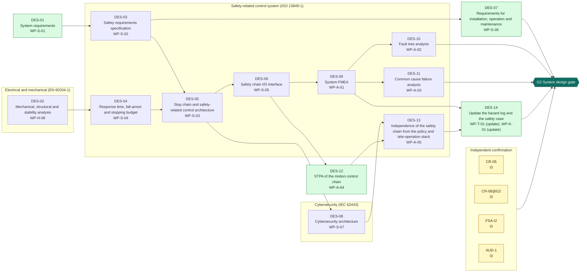
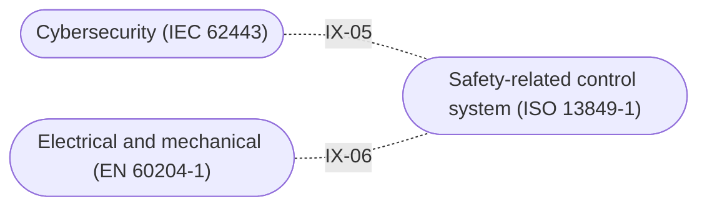

<!-- GENERATED by assurance/process/tools/process_model.py from assurance/process/model/. Do not edit; edit the model and re-run. -->

# G2 System design: integrated process map (L1)

Back to the [lifecycle map](lifecycle.md). Model: [`model/`](../model/), method: [process README](../README.md).

## 1. Swimlane map

One box per discipline; green activities are joint work of all disciplines and sit outside the boxes. Arrows are work-product inputs: an activity cannot finish before its inputs exist. An arrow implied by a longer path is left out; §2 lists every input. Iteration between disciplines is shown in the interface map (§1.1), not here.

### 1.1 Interface map

Where one discipline's analysis depends on another's. Each edge lists the interfaces of §3 between two lanes; OPEN marks one that a recorded open item still has to settle.

## 2. Activities

Clause references and status are read from the [register (WP-M-00)](../../01-management/WP-M-00-work-product-register.md) row of each work product the activity produces or, for a living work product, updates (marked *update*).

| Activity | Lane | Produces | Inputs | Machinery | SRP/CS | IEC 62443 | Other | ASPICE | Status |
|---|---|---|---|---|---|---|---|---|---|
| DES-01 System requirements | Joint (all disciplines) | [WP-S-01](../../03-system/WP-S-01-system-requirements.md) | WP-C-01, WP-C-02 |  |  |  |  | SYS.2 | Skeleton |
| DES-02 Mechanical, structural and stability analysis | Electrical and mechanical (EN 60204-1) | [WP-H-08](../../04-hardware/WP-H-08-mechanical-and-stability-analysis.md) | WP-C-01, WP-C-03 | 12100 §5.3, §6.2; 13482 §5.4, §5.13; 10218-1 §5.10 |  |  | ISO 13857; Machinery Reg. Annex III §1.3 |  | Skeleton |
| DES-03 Safety requirements specification | Safety-related control system (ISO 13849-1) | [WP-S-02](../../03-system/WP-S-02-safety-requirements.md) | WP-C-04, WP-C-05, WP-S-01 | 10218-1 §5.4; 13482 §6 | 13849-1 §5; 62061 §6 |  | 60204-1 §9 | SYS.2 | Skeleton |
| DES-04 Response time, fall-arrest and stopping budget | Safety-related control system (ISO 13849-1) | [WP-S-04](../../03-system/WP-S-04-response-time-and-stopping-budget.md) | WP-C-04, WP-C-06, WP-H-08 | 13482 §5.10, §5.13 | 13849-1 §5 (response time) |  |  | SYS.3 | Skeleton |
| DES-05 Stop chain and safety-related control architecture | Safety-related control system (ISO 13849-1) | [WP-S-03](../../03-system/WP-S-03-technical-safety-concept.md) | WP-S-02, WP-S-04 | 10218-1 §5.4, §5.5 | 13849-1 §6 |  | 60204-1 §9.4 | SYS.3 | Skeleton |
| DES-06 Safety chain I/O interface | Safety-related control system (ISO 13849-1) | [WP-S-05](../../03-system/WP-S-05-safety-chain-io-interface.md) | WP-S-03 |  | 13849-1 §6, §7 |  |  | SYS.3 | Skeleton |
| DES-07 Requirements for installation, operation and maintenance | Joint (all disciplines) | [WP-S-06](../../03-system/WP-S-06-requirements-installation-operation.md) | WP-C-05, WP-S-02 | 12100 §6.4; 13482 §7 | 13849-1 §11 | 62443-4-1 SG-1…SG-7 |  | SYS.2 | Skeleton |
| DES-08 Cybersecurity architecture | Cybersecurity (IEC 62443) | [WP-S-07](../../03-system/WP-S-07-cybersecurity-architecture.md) | WP-C-08, WP-S-03 |  |  | 62443-4-1 SD-1…SD-4; 62443-3-3 §5 |  | SEC.1, SYS.3 | Skeleton |
| DES-09 System FMEA | Safety-related control system (ISO 13849-1) | [WP-A-01](../../08-analyses/WP-A-01-system-fmea.md) | WP-S-03, WP-S-05 |  | 13849-1 §6 |  | IEC 60812 |  | Skeleton |
| DES-10 Fault tree analysis | Safety-related control system (ISO 13849-1) | [WP-A-02](../../08-analyses/WP-A-02-fault-tree-analysis.md) | WP-A-01 |  | 13849-1 §6 |  | IEC 61025 |  | Skeleton |
| DES-11 Common cause failure analysis | Safety-related control system (ISO 13849-1) | [WP-A-03](../../08-analyses/WP-A-03-common-cause-failure-analysis.md) | WP-S-03, WP-A-01 |  | 13849-1 §6, Annex F |  |  |  | Skeleton |
| DES-12 STPA of the motion control chain | Joint (all disciplines) | [WP-A-04](../../08-analyses/WP-A-04-stpa.md) | WP-S-03, WP-S-05, WP-C-10 | 12100 §5.4 |  |  | STPA Handbook 2018 |  | Skeleton |
| DES-13 Independence of the safety chain from the policy and tele-operation stack | Safety-related control system (ISO 13849-1) | [WP-A-05](../../08-analyses/WP-A-05-independence-of-the-safety-chain.md) | WP-S-03, WP-S-07, WP-A-04 |  | 13849-1 §6, §7; 61508-3 Annex F | 62443-3-3 §5 (zoning) |  |  | Skeleton |
| DES-14 Update the hazard log and the safety case | Joint (all disciplines) | [WP-T-01](../../trace/README.md) *update*, [WP-K-01](../../10-safety-case/WP-K-01-safety-case.md) *update* | WP-S-02, WP-A-01, WP-A-05 |  | 13849-1 §5; 61508-3 §7.2; 61508-1 §8 (assessment input) | 62443-4-1 SR-5 | UL 4600; Machinery Reg. Annex IV | consistency evidence (SYS.2–5, SWE.1–6) | Draft, Skeleton |

## 3. Cross-domain interfaces

Each interface is anchored to text in the work products; the checker fails if an anchor disappears. *Documented* means the documents reference each other but nobody has reviewed the agreement yet.

| ID | Pattern | Between | Topic | Status | Open item | Due |
|---|---|---|---|---|---|---|
| IX-05 | Safety-Security | [WP-S-03](../../03-system/WP-S-03-technical-safety-concept.md), [WP-S-07](../../03-system/WP-S-07-cybersecurity-architecture.md) (Safety-related control system / Cybersecurity) | The safety chain is a zone with no conduit from the tele-operation network; no chain input is reachable from software or the network | Documented | — | G2 |
| IX-06 | Control-Mechanical | [WP-S-04](../../03-system/WP-S-04-response-time-and-stopping-budget.md), [WP-H-08](../../04-hardware/WP-H-08-mechanical-and-stability-analysis.md) (Safety-related control system / Electrical and mechanical) | The controlled descent the fall-arrest budget assumes must stay inside the fall energy and the tip-over margin the mechanical analysis gives | Documented | — | G2 |

## 4. Clause coverage by standard

Which activity answers each clause reference listed in the register. One activity can answer several standards; that is the point of the integrated lifecycle.

- **Machinery:** 12100 §5.3, §6.2; 13482 §5.4, §5.13; 10218-1 §5.10 → DES-02; 10218-1 §5.4; 13482 §6 → DES-03; 13482 §5.10, §5.13 → DES-04; 10218-1 §5.4, §5.5 → DES-05; 12100 §6.4; 13482 §7 → DES-07; 12100 §5.4 → DES-12
- **SRP/CS:** 13849-1 §5; 62061 §6 → DES-03; 13849-1 §5 (response time) → DES-04; 13849-1 §6 → DES-05, DES-09, DES-10; 13849-1 §6, §7 → DES-06; 13849-1 §11 → DES-07; 13849-1 §6, Annex F → DES-11; 13849-1 §6, §7; 61508-3 Annex F → DES-13; 13849-1 §5; 61508-3 §7.2 → DES-14; 61508-1 §8 (assessment input) → DES-14
- **IEC 62443:** 62443-4-1 SG-1…SG-7 → DES-07; 62443-4-1 SD-1…SD-4; 62443-3-3 §5 → DES-08; 62443-3-3 §5 (zoning) → DES-13; 62443-4-1 SR-5 → DES-14
- **Other:** ISO 13857; Machinery Reg. Annex III §1.3 → DES-02; 60204-1 §9 → DES-03; 60204-1 §9.4 → DES-05; IEC 60812 → DES-09; IEC 61025 → DES-10; STPA Handbook 2018 → DES-12; UL 4600; Machinery Reg. Annex IV → DES-14
- **ASPICE:** SYS.2 → DES-01, DES-03, DES-07; SYS.3 → DES-04, DES-05, DES-06; SEC.1, SYS.3 → DES-08; consistency evidence (SYS.2–5, SWE.1–6) → DES-14

## 5. G2 readiness

**Exit criterion (WP-M-00 §2):** Safety requirements specification, safety-related control architecture with categories and diagnostics, response-time and fall-arrest budget, mechanical and stability analysis and system-level analyses approved

**Work products:** 1 Draft, 14 Skeleton of 15. Approval needs the verification review of [WP-P-05](../../07-supporting/WP-P-05-verification-review-procedure.md).

**Roles the lanes need (WP-M-02 §3.1):**

| Lane | Role | Assigned to | Needed by |
|---|---|---|---|
| Joint (all disciplines) | Safety manager | Jherrod Thomas (acting) | G0 |
| Safety-related control system (ISO 13849-1) | Safety-related control system engineer | Jherrod Thomas (acting); additional contributors TBD | G2 |
| Electrical and mechanical (EN 60204-1) | Electrical and mechanical engineer | TBD (likely external) | G2 |
| Cybersecurity (IEC 62443) | Cybersecurity manager | Jherrod Thomas (acting); permanent holder TBD | G1 |
| Independent confirmation | External functional safety assessor | None for now (DQ-010 A, decided 2026-10-21): every I2 and I3 measure unscheduled; revisit at G1 | G1 (revisit) |

**Other roles WP-M-02 §3.1 needs by G2:** Firmware and software engineer(s) (Jherrod Thomas; additional contributors TBD); Verification reviewer(s) (TBD; a public call for one reviewer with machinery-safety or robotics experience is open in CONTRIBUTING.md (DQ-029 A, decided 2026-10-21) and is posted by the lead on upstream's Discord and forum (DQ-046 A; draft in WP-M-10 §5), starting with WP-C-03 and WP-C-04; needed by G0, still unassigned); Quality assurance (TBD (independent of the author); needed by G0, still unassigned); Test operator(s) (TBD (trained per WP-M-04); needed by G1, still unassigned).

**Confirmation measures (WP-M-06 §9):**

| Measure | Covers | Independence | Record |
|---|---|---|---|
| CR-05 Confirmation review of the SRS and SRP/CS architecture | WP-S-02, WP-S-03, WP-S-04, WP-S-05 | I3 | Not performed |
| CR-06@G2 Confirmation review of the system-level safety analyses | WP-A-01, WP-A-02, WP-A-03, WP-A-04, WP-A-05, WP-H-08 | I3 | Not performed |
| FSA-I2 Interim functional safety assessment | WP-S-02, WP-S-03, WP-S-04, WP-S-05, WP-A-01, WP-A-02, WP-A-03, WP-A-04, WP-A-05 | I3 | Not performed |
| AUD-1 Functional safety audit of configuration, change and review | WP-P-01, WP-P-02, WP-P-05 | I3 | Not performed |

**Work products with no confirmation measure at this gate** (verification review only): WP-S-01, WP-S-06, WP-S-07, WP-T-01, WP-K-01.

**Open interfaces due by this gate** (from this or an earlier phase): none.
