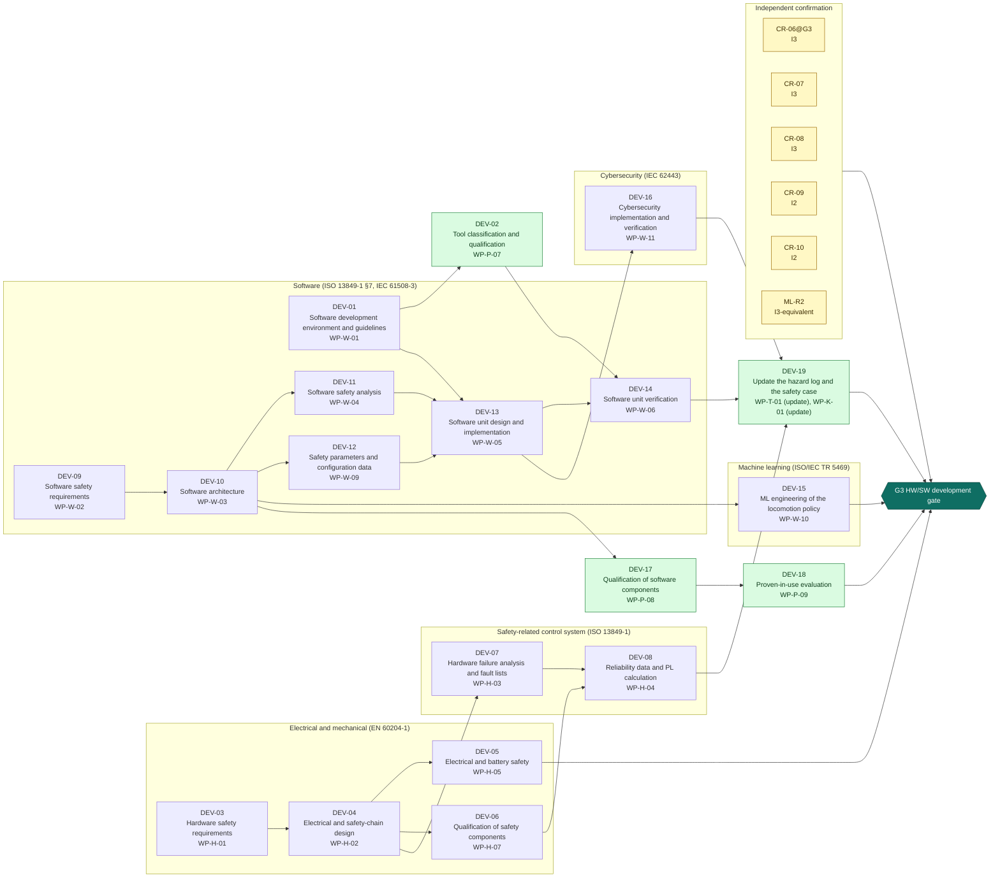
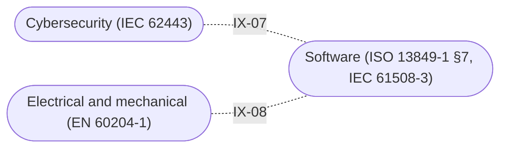

<!-- GENERATED by assurance/process/tools/process_model.py from assurance/process/model/. Do not edit; edit the model and re-run. -->

# G3 HW/SW development: integrated process map (L1)

Back to the [lifecycle map](lifecycle.md). Model: [`model/`](../model/), method: [process README](../README.md).

## 1. Swimlane map

One box per discipline; green activities are joint work of all disciplines and sit outside the boxes. Arrows are work-product inputs: an activity cannot finish before its inputs exist. An arrow implied by a longer path is left out; §2 lists every input. Iteration between disciplines is shown in the interface map (§1.1), not here.

### 1.1 Interface map

Where one discipline's analysis depends on another's. Each edge lists the interfaces of §3 between two lanes; OPEN marks one that a recorded open item still has to settle.

## 2. Activities

Clause references and status are read from the [register (WP-M-00)](../../01-management/WP-M-00-work-product-register.md) row of each work product the activity produces or, for a living work product, updates (marked *update*).

| Activity | Lane | Produces | Inputs | Machinery | SRP/CS | IEC 62443 | Other | ASPICE | Status |
|---|---|---|---|---|---|---|---|---|---|
| DEV-01 Software development environment and guidelines | Software (ISO 13849-1 §7, IEC 61508-3) | [WP-W-01](../../05-software/WP-W-01-software-development-environment-guidelines.md) | WP-M-02, WP-P-01 |  | 13849-1 §7; 61508-3 §7.4.4 | 62443-4-1 SI-1, SI-2 | MISRA C:2012 (firmware) | SWE.3 | Skeleton |
| DEV-02 Tool classification and qualification | Joint (all disciplines) | [WP-P-07](../../07-supporting/WP-P-07-tool-classification-qualification.md) | WP-W-01, WP-M-02 |  | 61508-3 §7.4.4 (T1–T3); 13849-1 §7 | 62443-4-1 SM-7 |  |  | Skeleton |
| DEV-03 Hardware safety requirements | Electrical and mechanical (EN 60204-1) | [WP-H-01](../../04-hardware/WP-H-01-hardware-safety-requirements.md) | WP-S-02, WP-S-03, WP-S-05 | 10218-1 §5.4; 13482 §5.16 | 13849-1 §5, §6 |  | 60204-1 §9.2 | HWE.1 | Skeleton |
| DEV-04 Electrical and safety-chain design | Electrical and mechanical (EN 60204-1) | [WP-H-02](../../04-hardware/WP-H-02-electrical-and-safety-chain-design.md) | WP-H-01, WP-S-04 |  | 13849-1 §6 | 62443-4-2 CR 2.13 (physical) | 60204-1 §5–§13 | HWE.2 | Skeleton |
| DEV-05 Electrical and battery safety | Electrical and mechanical (EN 60204-1) | [WP-H-05](../../04-hardware/WP-H-05-electrical-safety.md) | WP-H-02 |  |  |  | 60204-1 §5–§8, §18; 62133-2; UN 38.3 |  | Skeleton |
| DEV-06 Qualification of safety components | Electrical and mechanical (EN 60204-1) | [WP-H-07](../../04-hardware/WP-H-07-safety-component-qualification.md) | WP-H-01, WP-H-02, WP-M-10 |  | 13849-1 §6 (well-tried components); 13849-2 Annex A–D; 62061 §7 (subsystems) |  | 62133-2 (pack certificate) |  | Skeleton |
| DEV-07 Hardware failure analysis and fault lists | Safety-related control system (ISO 13849-1) | [WP-H-03](../../04-hardware/WP-H-03-hardware-failure-analysis.md) | WP-H-02, WP-A-01 |  | 13849-1 §6; 13849-2 Annex A–D |  | IEC 60812 | HWE.2 | Skeleton |
| DEV-08 Reliability data and PL calculation | Safety-related control system (ISO 13849-1) | [WP-H-04](../../04-hardware/WP-H-04-reliability-data-and-pl-calculation.md) | WP-H-03, WP-H-07, WP-A-03 |  | 13849-1 §6, Annex C–F, Annex K |  |  |  | Skeleton |
| DEV-09 Software safety requirements | Software (ISO 13849-1 §7, IEC 61508-3) | [WP-W-02](../../05-software/WP-W-02-software-safety-requirements.md) | WP-S-02, WP-S-05, WP-A-04 |  | 13849-1 §7; 61508-3 §7.2 |  |  | SWE.1 | Skeleton |
| DEV-10 Software architecture | Software (ISO 13849-1 §7, IEC 61508-3) | [WP-W-03](../../05-software/WP-W-03-software-architecture.md) | WP-W-02, WP-S-05, WP-A-05 |  | 13849-1 §7; 61508-3 §7.4.3 | 62443-4-1 SD-2 |  | SWE.2 | Skeleton |
| DEV-11 Software safety analysis | Software (ISO 13849-1 §7, IEC 61508-3) | [WP-W-04](../../05-software/WP-W-04-software-safety-analysis.md) | WP-W-03 |  | 13849-1 §7; 61508-3 §7.4.3 |  | IEC 60812 (software FMEA) | SWE.2 | Skeleton |
| DEV-12 Safety parameters and configuration data | Software (ISO 13849-1 §7, IEC 61508-3) | [WP-W-09](../../05-software/WP-W-09-safety-parameters-and-configuration-data.md) | WP-S-04, WP-W-03 | 13482 §5.10; TS 15066 §5.5 | 13849-1 §7 (parameterization) | 62443-4-2 CR 3.4 |  | SWE.3 | Skeleton |
| DEV-13 Software unit design and implementation | Software (ISO 13849-1 §7, IEC 61508-3) | [WP-W-05](../../05-software/WP-W-05-software-unit-design.md) | WP-W-01, WP-W-03, WP-W-04, WP-W-09 |  | 13849-1 §7; 61508-3 §7.4.5, §7.4.6 | 62443-4-1 SI-1 |  | SWE.3 | Skeleton |
| DEV-14 Software unit verification | Software (ISO 13849-1 §7, IEC 61508-3) | [WP-W-06](../../05-software/WP-W-06-software-unit-verification.md) | WP-W-05, WP-P-07 |  | 13849-1 §7, §8; 61508-3 §7.4.7 | 62443-4-1 SVV-1 |  | SWE.4 | Skeleton |
| DEV-15 ML engineering of the locomotion policy | Machine learning (ISO/IEC TR 5469) | [WP-W-10](../../05-software/WP-W-10-ml-engineering.md) | WP-C-09, WP-W-03 |  |  |  | TR 5469 §8–§10; AI Act Art. 10, Art. 15 | MLE.1–4, SUP.11 | Skeleton |
| DEV-16 Cybersecurity implementation and verification | Cybersecurity (IEC 62443) | [WP-W-11](../../05-software/WP-W-11-cybersecurity-implementation-verification.md) | WP-C-08, WP-S-07, WP-W-09, WP-W-05 |  |  | 62443-4-1 SI-1, SI-2, SVV-1…SVV-4; 62443-4-2 CR |  | SEC.2, SEC.3 | Skeleton |
| DEV-17 Qualification of software components | Joint (all disciplines) | [WP-P-08](../../07-supporting/WP-P-08-software-component-qualification.md) | WP-W-03, WP-M-10 |  | 61508-3 §7.4.2.12 | 62443-4-1 SM-9, SM-10 |  |  | Skeleton |
| DEV-18 Proven-in-use evaluation | Joint (all disciplines) | [WP-P-09](../../07-supporting/WP-P-09-proven-in-use.md) | WP-M-10, WP-P-08 |  | 61508-2 §7.4.10; 61508-3 §7.4.2.12 |  |  |  | Skeleton |
| DEV-19 Update the hazard log and the safety case | Joint (all disciplines) | [WP-T-01](../../trace/README.md) *update*, [WP-K-01](../../10-safety-case/WP-K-01-safety-case.md) *update* | WP-H-04, WP-W-06, WP-W-11 |  | 13849-1 §5; 61508-3 §7.2; 61508-1 §8 (assessment input) | 62443-4-1 SR-5 | UL 4600; Machinery Reg. Annex IV | consistency evidence (SYS.2–5, SWE.1–6) | Draft, Skeleton |

## 3. Cross-domain interfaces

Each interface is anchored to text in the work products; the checker fails if an anchor disappears. *Documented* means the documents reference each other but nobody has reviewed the agreement yet.

| ID | Pattern | Between | Topic | Status | Open item | Due |
|---|---|---|---|---|---|---|
| IX-07 | Safety-Security | [WP-W-09](../../05-software/WP-W-09-safety-parameters-and-configuration-data.md), [WP-W-11](../../05-software/WP-W-11-cybersecurity-implementation-verification.md) (Software / Cybersecurity) | Safety parameters (joint limits, timeouts, PFL thresholds) are protected assets; their integrity is a cybersecurity requirement | Documented | — | G3 |
| IX-08 | Software-Hardware | [WP-W-03](../../05-software/WP-W-03-software-architecture.md), [WP-H-02](../../04-hardware/WP-H-02-electrical-and-safety-chain-design.md) (Software / Electrical and mechanical) | The firmware reads chain diagnostics through the I/O of WP-S-05; those signals are informative and never a channel of a safety function | Documented | — | G3 |

## 4. Clause coverage by standard

Which activity answers each clause reference listed in the register. One activity can answer several standards; that is the point of the integrated lifecycle.

- **Machinery:** 10218-1 §5.4; 13482 §5.16 → DEV-03; 13482 §5.10; TS 15066 §5.5 → DEV-12
- **SRP/CS:** 13849-1 §7; 61508-3 §7.4.4 → DEV-01; 61508-3 §7.4.4 (T1–T3); 13849-1 §7 → DEV-02; 13849-1 §5, §6 → DEV-03; 13849-1 §6 → DEV-04; 13849-1 §6 (well-tried components); 13849-2 Annex A–D; 62061 §7 (subsystems) → DEV-06; 13849-1 §6; 13849-2 Annex A–D → DEV-07; 13849-1 §6, Annex C–F, Annex K → DEV-08; 13849-1 §7; 61508-3 §7.2 → DEV-09; 13849-1 §7; 61508-3 §7.4.3 → DEV-10, DEV-11; 13849-1 §7 (parameterization) → DEV-12; 13849-1 §7; 61508-3 §7.4.5, §7.4.6 → DEV-13; 13849-1 §7, §8; 61508-3 §7.4.7 → DEV-14; 61508-3 §7.4.2.12 → DEV-17; 61508-2 §7.4.10; 61508-3 §7.4.2.12 → DEV-18; 13849-1 §5; 61508-3 §7.2 → DEV-19; 61508-1 §8 (assessment input) → DEV-19
- **IEC 62443:** 62443-4-1 SI-1, SI-2 → DEV-01; 62443-4-1 SM-7 → DEV-02; 62443-4-2 CR 2.13 (physical) → DEV-04; 62443-4-1 SD-2 → DEV-10; 62443-4-2 CR 3.4 → DEV-12; 62443-4-1 SI-1 → DEV-13; 62443-4-1 SVV-1 → DEV-14; 62443-4-1 SI-1, SI-2, SVV-1…SVV-4; 62443-4-2 CR → DEV-16; 62443-4-1 SM-9, SM-10 → DEV-17; 62443-4-1 SR-5 → DEV-19
- **Other:** MISRA C:2012 (firmware) → DEV-01; 60204-1 §9.2 → DEV-03; 60204-1 §5–§13 → DEV-04; 60204-1 §5–§8, §18; 62133-2; UN 38.3 → DEV-05; 62133-2 (pack certificate) → DEV-06; IEC 60812 → DEV-07; IEC 60812 (software FMEA) → DEV-11; TR 5469 §8–§10; AI Act Art. 10, Art. 15 → DEV-15; UL 4600; Machinery Reg. Annex IV → DEV-19
- **ASPICE:** SWE.3 → DEV-01, DEV-12, DEV-13; HWE.1 → DEV-03; HWE.2 → DEV-04, DEV-07; SWE.1 → DEV-09; SWE.2 → DEV-10, DEV-11; SWE.4 → DEV-14; MLE.1–4, SUP.11 → DEV-15; SEC.2, SEC.3 → DEV-16; consistency evidence (SYS.2–5, SWE.1–6) → DEV-19

## 5. G3 readiness

**Exit criterion (WP-M-00 §2):** Safety-chain hardware and PL calculation, software requirements, architecture, units and unit verification approved for every safety-related part

**Work products:** 1 Draft, 19 Skeleton of 20. Approval needs the verification review of [WP-P-05](../../07-supporting/WP-P-05-verification-review-procedure.md).

**Roles the lanes need (WP-M-02 §3.1):**

| Lane | Role | Assigned to | Needed by |
|---|---|---|---|
| Joint (all disciplines) | Safety manager | Jherrod Thomas (acting) | G0 |
| Safety-related control system (ISO 13849-1) | Safety-related control system engineer | Jherrod Thomas (acting); additional contributors TBD | G2 |
| Electrical and mechanical (EN 60204-1) | Electrical and mechanical engineer | TBD (likely external) | G2 |
| Software (ISO 13849-1 §7, IEC 61508-3) | Firmware and software engineer(s) | Jherrod Thomas; additional contributors TBD | G2 |
| Cybersecurity (IEC 62443) | Cybersecurity manager | Jherrod Thomas (acting); permanent holder TBD | G1 |
| Machine learning (ISO/IEC TR 5469) | ML safety lead | Jherrod Thomas (acting); permanent holder TBD | G1 |
| Independent confirmation | External functional safety assessor | None for now (DQ-010 A, decided 2026-10-21): every I2 and I3 measure unscheduled; revisit at G1 | G1 (revisit) |

**Other roles WP-M-02 §3.1 needs by G3:** Verification reviewer(s) (TBD; a public call for one reviewer with machinery-safety or robotics experience is open in CONTRIBUTING.md (DQ-029 A, decided 2026-10-21), starting with WP-C-03 and WP-C-04; needed by G0, still unassigned); Quality assurance (TBD (independent of the author); needed by G0, still unassigned); Test bench owner (TBD); Test operator(s) (TBD (trained per WP-M-04); needed by G1, still unassigned).

**Confirmation measures (WP-M-06 §9):**

| Measure | Covers | Independence | Record |
|---|---|---|---|
| CR-06@G3 Confirmation review of the hardware and software safety analyses | WP-H-03, WP-W-04 | I3 | Not performed |
| CR-07 Confirmation review of the PL calculation | WP-H-04 | I3 | Not performed |
| CR-08 Confirmation review of the safety component qualification | WP-H-07 | I3 | Not performed |
| CR-09 Confirmation review of the tool qualification | WP-P-07 | I2 | Not performed |
| CR-10 Confirmation review of the software component qualification | WP-P-08 | I2 | Not performed |
| ML-R2 Review of the ML engineering evidence | WP-W-10 | I3-equivalent | Not performed |

**Work products with no confirmation measure at this gate** (verification review only): WP-W-01, WP-H-01, WP-H-02, WP-H-05, WP-W-02, WP-W-03, WP-W-09, WP-W-05, WP-W-06, WP-W-11, WP-P-09, WP-T-01, WP-K-01.

**Open interfaces due by this gate** (from this or an earlier phase): none.
