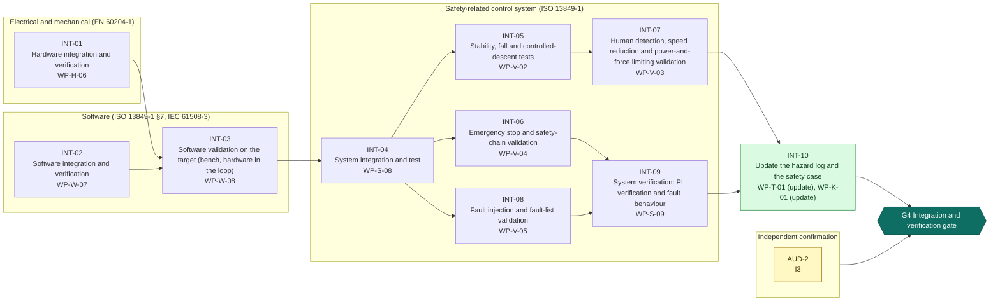
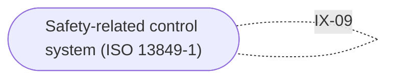

<!-- GENERATED by assurance/process/tools/process_model.py from assurance/process/model/. Do not edit; edit the model and re-run. -->

# G4 Integration and verification: integrated process map (L1)

Back to the [lifecycle map](lifecycle.md). Model: [`model/`](../model/), method: [process README](../README.md).

## 1. Swimlane map

One box per discipline; green activities are joint work of all disciplines and sit outside the boxes. Arrows are work-product inputs: an activity cannot finish before its inputs exist. An arrow implied by a longer path is left out; §2 lists every input. Iteration between disciplines is shown in the interface map (§1.1), not here.

### 1.1 Interface map

Where one discipline's analysis depends on another's. Each edge lists the interfaces of §3 between two lanes; OPEN marks one that a recorded open item still has to settle.

## 2. Activities

Clause references and status are read from the [register (WP-M-00)](../../01-management/WP-M-00-work-product-register.md) row of each work product the activity produces or, for a living work product, updates (marked *update*).

| Activity | Lane | Produces | Inputs | Machinery | SRP/CS | IEC 62443 | Other | ASPICE | Status |
|---|---|---|---|---|---|---|---|---|---|
| INT-01 Hardware integration and verification | Electrical and mechanical (EN 60204-1) | [WP-H-06](../../04-hardware/WP-H-06-hardware-integration-verification.md) | WP-H-02, WP-H-05 |  | 13849-1 §8 |  | 60204-1 §18 | HWE.3, HWE.4 | Skeleton |
| INT-02 Software integration and verification | Software (ISO 13849-1 §7, IEC 61508-3) | [WP-W-07](../../05-software/WP-W-07-software-integration-verification.md) | WP-W-06 |  | 13849-1 §7, §8; 61508-3 §7.5 |  |  | SWE.5 | Skeleton |
| INT-03 Software validation on the target (bench, hardware in the loop) | Software (ISO 13849-1 §7, IEC 61508-3) | [WP-W-08](../../05-software/WP-W-08-software-validation-on-target.md) | WP-W-07, WP-H-06 |  | 13849-1 §10; 61508-3 §7.7 |  |  | SWE.6 | Skeleton |
| INT-04 System integration and test | Safety-related control system (ISO 13849-1) | [WP-S-08](../../03-system/WP-S-08-system-integration-test.md) | WP-H-06, WP-W-08 |  | 13849-1 §8 | 62443-4-1 SVV-1 |  | SYS.4 | Skeleton |
| INT-05 Stability, fall and controlled-descent tests | Safety-related control system (ISO 13849-1) | [WP-V-02](../../06-validation/WP-V-02-stopping-braking-stability-tests.md) | WP-S-04, WP-H-08, WP-S-08, WP-V-07 | 13482 §5.13, §7; 12100 §5.3 |  |  |  | VAL.1 | Skeleton |
| INT-06 Emergency stop and safety-chain validation | Safety-related control system (ISO 13849-1) | [WP-V-04](../../06-validation/WP-V-04-emergency-stop-and-safety-chain-validation.md) | WP-S-08, WP-V-07 | 13850 §4; 13482 §5.16 | 13849-2 §5 |  | 60204-1 §9.2, §18 | VAL.1 | Skeleton |
| INT-07 Human detection, speed reduction and power-and-force limiting validation | Safety-related control system (ISO 13849-1) | [WP-V-03](../../06-validation/WP-V-03-personnel-detection-validation.md) | WP-V-02, WP-W-09, WP-V-07 | 10218-2 §5; TS 15066 §5.5; 13482 §5.7, §7 | 13849-1 §10 |  | ISO 13857 | VAL.1 | Skeleton |
| INT-08 Fault injection and fault-list validation | Safety-related control system (ISO 13849-1) | [WP-V-05](../../06-validation/WP-V-05-fault-injection.md) | WP-H-03, WP-W-04, WP-S-08 |  | 13849-2 §5, Annex A–D |  |  | SYS.4, SWE.6 | Skeleton |
| INT-09 System verification: PL verification and fault behaviour | Safety-related control system (ISO 13849-1) | [WP-S-09](../../03-system/WP-S-09-system-verification.md) | WP-H-04, WP-V-05, WP-V-04 |  | 13849-1 §8; 13849-2 §4–§5 |  | 60204-1 §18 | SYS.5 | Skeleton |
| INT-10 Update the hazard log and the safety case | Joint (all disciplines) | [WP-T-01](../../trace/README.md) *update*, [WP-K-01](../../10-safety-case/WP-K-01-safety-case.md) *update* | WP-S-09, WP-V-02, WP-V-03 |  | 13849-1 §5; 61508-3 §7.2; 61508-1 §8 (assessment input) | 62443-4-1 SR-5 | UL 4600; Machinery Reg. Annex IV | consistency evidence (SYS.2–5, SWE.1–6) | Draft, Skeleton |

## 3. Cross-domain interfaces

Each interface is anchored to text in the work products; the checker fails if an anchor disappears. *Documented* means the documents reference each other but nobody has reviewed the agreement yet.

| ID | Pattern | Between | Topic | Status | Open item | Due |
|---|---|---|---|---|---|---|
| IX-09 | Test-Test | [WP-V-02](../../06-validation/WP-V-02-stopping-braking-stability-tests.md), [WP-V-03](../../06-validation/WP-V-03-personnel-detection-validation.md) (Safety-related control system / Safety-related control system) | The contact and speed limits validated in WP-V-03 depend on the controlled-descent time and the fall energy measured in WP-V-02 | Documented | — | G4 |

## 4. Clause coverage by standard

Which activity answers each clause reference listed in the register. One activity can answer several standards; that is the point of the integrated lifecycle.

- **Machinery:** 13482 §5.13, §7; 12100 §5.3 → INT-05; 13850 §4; 13482 §5.16 → INT-06; 10218-2 §5; TS 15066 §5.5; 13482 §5.7, §7 → INT-07
- **SRP/CS:** 13849-1 §8 → INT-01, INT-04; 13849-1 §7, §8; 61508-3 §7.5 → INT-02; 13849-1 §10; 61508-3 §7.7 → INT-03; 13849-2 §5 → INT-06; 13849-1 §10 → INT-07; 13849-2 §5, Annex A–D → INT-08; 13849-1 §8; 13849-2 §4–§5 → INT-09; 13849-1 §5; 61508-3 §7.2 → INT-10; 61508-1 §8 (assessment input) → INT-10
- **IEC 62443:** 62443-4-1 SVV-1 → INT-04; 62443-4-1 SR-5 → INT-10
- **Other:** 60204-1 §18 → INT-01, INT-09; 60204-1 §9.2, §18 → INT-06; ISO 13857 → INT-07; UL 4600; Machinery Reg. Annex IV → INT-10
- **ASPICE:** HWE.3, HWE.4 → INT-01; SWE.5 → INT-02; SWE.6 → INT-03; SYS.4 → INT-04; VAL.1 → INT-05, INT-06, INT-07; SYS.4, SWE.6 → INT-08; SYS.5 → INT-09; consistency evidence (SYS.2–5, SWE.1–6) → INT-10

## 5. G4 readiness

**Exit criterion (WP-M-00 §2):** Hardware, software and system integration and PL verification complete; stability, fall, E-stop and detection tests passed; fault-injection campaign closed

**Work products:** 1 Draft, 10 Skeleton of 11. Approval needs the verification review of [WP-P-05](../../07-supporting/WP-P-05-verification-review-procedure.md).

**Roles the lanes need (WP-M-02 §3.1):**

| Lane | Role | Assigned to | Needed by |
|---|---|---|---|
| Joint (all disciplines) | Safety manager | Jherrod Thomas (acting) | G0 |
| Safety-related control system (ISO 13849-1) | Safety-related control system engineer | Jherrod Thomas (acting); additional contributors TBD | G2 |
| Electrical and mechanical (EN 60204-1) | Electrical and mechanical engineer | TBD (likely external) | G2 |
| Software (ISO 13849-1 §7, IEC 61508-3) | Firmware and software engineer(s) | Jherrod Thomas; additional contributors TBD | G2 |
| Independent confirmation | External functional safety assessor | None for now (DQ-010 A, decided 2026-10-21): every I2 and I3 measure unscheduled; revisit at G1 | G1 (revisit) |

**Other roles WP-M-02 §3.1 needs by G4:** Verification reviewer(s) (TBD; a public call for one reviewer with machinery-safety or robotics experience is open in CONTRIBUTING.md (DQ-029 A, decided 2026-10-21) and is posted by the lead on upstream's Discord and forum (DQ-046 A; draft in WP-M-10 §5), starting with WP-C-03 and WP-C-04; needed by G0, still unassigned); Quality assurance (TBD (independent of the author); needed by G0, still unassigned); Test bench owner (TBD; needed by G3, still unassigned); Test operator(s) (TBD (trained per WP-M-04); needed by G1, still unassigned).

**Confirmation measures (WP-M-06 §9):**

| Measure | Covers | Independence | Record |
|---|---|---|---|
| AUD-2 Functional safety audit of the bench campaign, test records and tool use | WP-P-03, WP-P-07, WP-W-08 | I3 | Not performed |

**Work products with no confirmation measure at this gate** (verification review only): WP-H-06, WP-W-07, WP-S-08, WP-V-02, WP-V-04, WP-V-03, WP-V-05, WP-S-09, WP-T-01, WP-K-01.

**Open interfaces due by this gate** (from this or an earlier phase): none.
