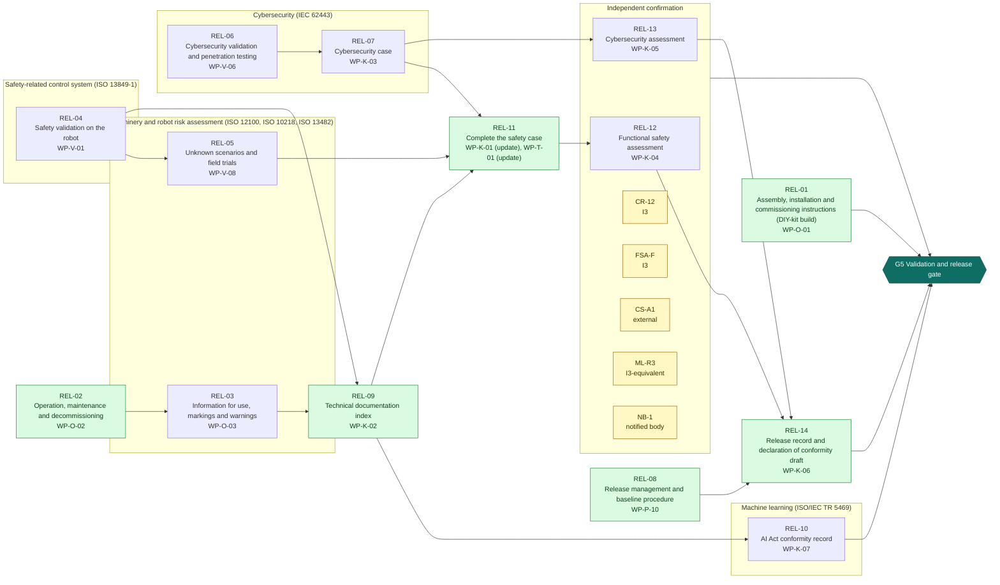
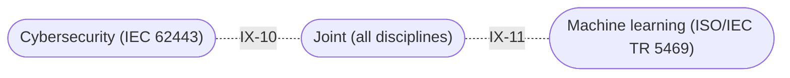

<!-- GENERATED by assurance/process/tools/process_model.py from assurance/process/model/. Do not edit; edit the model and re-run. -->

# G5 Validation and release: integrated process map (L1)

Back to the [lifecycle map](lifecycle.md). Model: [`model/`](../model/), method: [process README](../README.md).

## 1. Swimlane map

One box per discipline; green activities are joint work of all disciplines and sit outside the boxes. Arrows are work-product inputs: an activity cannot finish before its inputs exist. An arrow implied by a longer path is left out; §2 lists every input. Iteration between disciplines is shown in the interface map (§1.1), not here.

### 1.1 Interface map

Where one discipline's analysis depends on another's. Each edge lists the interfaces of §3 between two lanes; OPEN marks one that a recorded open item still has to settle.

## 2. Activities

Clause references and status are read from the [register (WP-M-00)](../../01-management/WP-M-00-work-product-register.md) row of each work product the activity produces or, for a living work product, updates (marked *update*).

| Activity | Lane | Produces | Inputs | Machinery | SRP/CS | IEC 62443 | Other | ASPICE | Status |
|---|---|---|---|---|---|---|---|---|---|
| REL-01 Assembly, installation and commissioning instructions (DIY-kit build) | Joint (all disciplines) | [WP-O-01](../../09-production-operation/WP-O-01-assembly-installation-commissioning.md) | WP-S-06, WP-H-02, WP-W-09 | 12100 §6.4; 13482 §7 |  |  | Machinery Reg. Annex III §1.7.4; ISO 9001 §8.5.1 (informative) |  | Skeleton |
| REL-02 Operation, maintenance and decommissioning | Joint (all disciplines) | [WP-O-02](../../09-production-operation/WP-O-02-operation-maintenance-decommissioning.md) | WP-S-06, WP-H-04 | 12100 §6.4; 13482 §7 | 13849-1 §11 | 62443-4-1 SG-1…SG-7 |  |  | Skeleton |
| REL-03 Information for use, markings and warnings | Machinery and robot risk assessment (ISO 12100, ISO 10218, ISO 13482) | [WP-O-03](../../09-production-operation/WP-O-03-information-for-use.md) | WP-C-05, WP-C-02, WP-O-02 | 12100 §6.4; 13482 §7.2 | 13849-1 §13 |  | Machinery Reg. Annex III §1.7 |  | Skeleton |
| REL-04 Safety validation on the robot | Safety-related control system (ISO 13849-1) | [WP-V-01](../../06-validation/WP-V-01-safety-validation.md) | WP-S-02, WP-S-09, WP-V-02, WP-V-03, WP-V-04, WP-V-05, WP-V-07 | 13482 §7; 10218-1 §6 | 13849-1 §10; 13849-2 §4 |  | 60204-1 §18 | VAL.1 | Skeleton |
| REL-05 Unknown scenarios and field trials | Machinery and robot risk assessment (ISO 12100, ISO 10218, ISO 13482) | [WP-V-08](../../06-validation/WP-V-08-unknown-scenarios-and-field-trials.md) | WP-C-10, WP-V-01, WP-V-07 | 13482 §7 |  |  | ISO 21448 §11 (informative) | VAL.1 | Skeleton |
| REL-06 Cybersecurity validation and penetration testing | Cybersecurity (IEC 62443) | [WP-V-06](../../06-validation/WP-V-06-cybersecurity-validation.md) | WP-S-07, WP-W-11 |  |  | 62443-4-1 SVV-3, SVV-4 |  | SEC.4 | Skeleton |
| REL-07 Cybersecurity case | Cybersecurity (IEC 62443) | [WP-K-03](../../10-safety-case/WP-K-03-cybersecurity-case.md) | WP-C-08, WP-V-06 |  |  | 62443-4-1 (practice evidence); 62443-4-2 (CR evidence) |  |  | Skeleton |
| REL-08 Release management and baseline procedure | Joint (all disciplines) | [WP-P-10](../../07-supporting/WP-P-10-release-management.md) | WP-P-01, WP-P-02 |  | 61508-1 §6.2.3 | 62443-4-1 SUM-1…SUM-5 | Machinery Reg. Annex V | SUP.8 | Skeleton |
| REL-09 Technical documentation index | Joint (all disciplines) | [WP-K-02](../../10-safety-case/WP-K-02-technical-documentation-index.md) | WP-M-13, WP-P-04, WP-V-01, WP-O-03 | 12100 §7 | 13849-1 §12 |  | Machinery Reg. Annex IV |  | Skeleton |
| REL-10 AI Act conformity record | Machine learning (ISO/IEC TR 5469) | [WP-K-07](../../10-safety-case/WP-K-07-ai-act-conformity-record.md) | WP-C-09, WP-W-10, WP-K-02 |  |  |  | AI Act Art. 6, Art. 43, Annex IV |  | Skeleton |
| REL-11 Complete the safety case | Joint (all disciplines) | [WP-K-01](../../10-safety-case/WP-K-01-safety-case.md) *update*, [WP-T-01](../../trace/README.md) *update* | WP-V-01, WP-V-08, WP-K-03, WP-K-02 |  | 61508-1 §8 (assessment input); 13849-1 §5; 61508-3 §7.2 | 62443-4-1 SR-5 | UL 4600; Machinery Reg. Annex IV | consistency evidence (SYS.2–5, SWE.1–6) | Draft, Skeleton |
| REL-12 Functional safety assessment | Independent confirmation | [WP-K-04](../../10-safety-case/WP-K-04-functional-safety-assessment.md) | WP-K-01, WP-V-01, WP-S-09 |  | 61508-1 §8 |  |  |  | Skeleton |
| REL-13 Cybersecurity assessment | Independent confirmation | [WP-K-05](../../10-safety-case/WP-K-05-cybersecurity-assessment.md) | WP-K-03, WP-V-06 |  |  | 62443-4-1 §4.3 (conformance) |  |  | Skeleton |
| REL-14 Release record and declaration of conformity draft | Joint (all disciplines) | [WP-K-06](../../10-safety-case/WP-K-06-release-record.md) | WP-K-02, WP-K-04, WP-K-05, WP-P-10 |  |  |  | Machinery Reg. Art. 21, Annex V | SUP.8 | Skeleton |

## 3. Cross-domain interfaces

Each interface is anchored to text in the work products; the checker fails if an anchor disappears. *Documented* means the documents reference each other but nobody has reviewed the agreement yet.

| ID | Pattern | Between | Topic | Status | Open item | Due |
|---|---|---|---|---|---|---|
| IX-10 | Safety-Security | [WP-K-01](../../10-safety-case/WP-K-01-safety-case.md), [WP-K-03](../../10-safety-case/WP-K-03-cybersecurity-case.md) (Joint / Cybersecurity) | The cybersecurity case is a branch of the safety case; claims that protect a safety function are referenced from the safety case | Documented | — | G5 |
| IX-11 | Regulatory-ML | [WP-K-02](../../10-safety-case/WP-K-02-technical-documentation-index.md), [WP-K-07](../../10-safety-case/WP-K-07-ai-act-conformity-record.md) (Joint / Machine learning) | One technical documentation serves the Machinery Regulation and, if the locomotion policy becomes a safety component, the AI Act | Documented | — | G5 |

## 4. Clause coverage by standard

Which activity answers each clause reference listed in the register. One activity can answer several standards; that is the point of the integrated lifecycle.

- **Machinery:** 12100 §6.4; 13482 §7 → REL-01, REL-02; 12100 §6.4; 13482 §7.2 → REL-03; 13482 §7; 10218-1 §6 → REL-04; 13482 §7 → REL-05; 12100 §7 → REL-09
- **SRP/CS:** 13849-1 §11 → REL-02; 13849-1 §13 → REL-03; 13849-1 §10; 13849-2 §4 → REL-04; 61508-1 §6.2.3 → REL-08; 13849-1 §12 → REL-09; 61508-1 §8 (assessment input) → REL-11; 13849-1 §5; 61508-3 §7.2 → REL-11; 61508-1 §8 → REL-12
- **IEC 62443:** 62443-4-1 SG-1…SG-7 → REL-02; 62443-4-1 SVV-3, SVV-4 → REL-06; 62443-4-1 (practice evidence); 62443-4-2 (CR evidence) → REL-07; 62443-4-1 SUM-1…SUM-5 → REL-08; 62443-4-1 SR-5 → REL-11; 62443-4-1 §4.3 (conformance) → REL-13
- **Other:** Machinery Reg. Annex III §1.7.4; ISO 9001 §8.5.1 (informative) → REL-01; Machinery Reg. Annex III §1.7 → REL-03; 60204-1 §18 → REL-04; ISO 21448 §11 (informative) → REL-05; Machinery Reg. Annex V → REL-08; Machinery Reg. Annex IV → REL-09; AI Act Art. 6, Art. 43, Annex IV → REL-10; UL 4600; Machinery Reg. Annex IV → REL-11; Machinery Reg. Art. 21, Annex V → REL-14
- **ASPICE:** VAL.1 → REL-04, REL-05; SEC.4 → REL-06; SUP.8 → REL-08, REL-14; consistency evidence (SYS.2–5, SWE.1–6) → REL-11

## 5. G5 readiness

**Exit criterion (WP-M-00 §2):** Safety validation on the robot, cybersecurity validation, safety case, functional safety assessment and technical documentation complete; release record signed

**Work products:** 1 Draft, 14 Skeleton of 15. Approval needs the verification review of [WP-P-05](../../07-supporting/WP-P-05-verification-review-procedure.md).

**Roles the lanes need (WP-M-02 §3.1):**

| Lane | Role | Assigned to | Needed by |
|---|---|---|---|
| Joint (all disciplines) | Safety manager | Jherrod Thomas (acting) | G0 |
| Machinery and robot risk assessment (ISO 12100, ISO 10218, ISO 13482) | Safety manager | Jherrod Thomas (acting) | G0 |
| Safety-related control system (ISO 13849-1) | Safety-related control system engineer | Jherrod Thomas (acting); additional contributors TBD | G2 |
| Cybersecurity (IEC 62443) | Cybersecurity manager | Jherrod Thomas (acting); permanent holder TBD | G1 |
| Machine learning (ISO/IEC TR 5469) | ML safety lead | Jherrod Thomas (acting); permanent holder TBD | G1 |
| Independent confirmation | External functional safety assessor | None for now (DQ-010 A, decided 2026-10-21): every I2 and I3 measure unscheduled; revisit at G1 | G1 (revisit) |

**Other roles WP-M-02 §3.1 needs by G5:** Electrical and mechanical engineer (TBD (likely external); needed by G2, still unassigned); Verification reviewer(s) (TBD; a public call for one reviewer with machinery-safety or robotics experience is open in CONTRIBUTING.md (DQ-029 A, decided 2026-10-21), starting with WP-C-03 and WP-C-04; needed by G0, still unassigned); Quality assurance (TBD (independent of the author); needed by G0, still unassigned); Test bench owner (TBD; needed by G3, still unassigned); Test operator(s) (TBD (trained per WP-M-04); needed by G1, still unassigned); External cybersecurity assessor (TBD); Notified body (TBD).

**Confirmation measures (WP-M-06 §9):**

| Measure | Covers | Independence | Record |
|---|---|---|---|
| CR-12 Confirmation review of the safety case | WP-K-01 | I3 | Not performed |
| FSA-F Final functional safety assessment | WP-K-01, WP-V-01 | I3 | Not performed |
| CS-A1 Cybersecurity assessment | WP-K-03, WP-V-06 | external | Not performed |
| ML-R3 Review of the AI Act conformity record | WP-K-07 | I3-equivalent | Not performed |
| NB-1 EU type-examination of the technical documentation (if the conformity route needs one) | WP-K-02, WP-K-06 | notified body | Not performed |

**Work products with no confirmation measure at this gate** (verification review only): WP-O-01, WP-O-02, WP-O-03, WP-V-08, WP-P-10, WP-T-01.

**Open interfaces due by this gate** (from this or an earlier phase): none.
