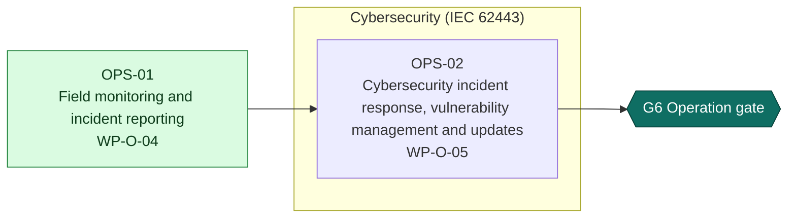

<!-- GENERATED by assurance/process/tools/process_model.py from assurance/process/model/. Do not edit; edit the model and re-run. -->

# G6 Operation: integrated process map (L1)

Back to the [lifecycle map](lifecycle.md). Model: [`model/`](../model/), method: [process README](../README.md).

## 1. Swimlane map

One box per discipline; green activities are joint work of all disciplines and sit outside the boxes. Arrows are work-product inputs: an activity cannot finish before its inputs exist. An arrow implied by a longer path is left out; §2 lists every input. Iteration between disciplines is shown in the interface map (§1.1), not here.

### 1.1 Interface map

Where one discipline's analysis depends on another's. Each edge lists the interfaces of §3 between two lanes; OPEN marks one that a recorded open item still has to settle.

## 2. Activities

Clause references and status are read from the [register (WP-M-00)](../../01-management/WP-M-00-work-product-register.md) row of each work product the activity produces or, for a living work product, updates (marked *update*).

| Activity | Lane | Produces | Inputs | Machinery | SRP/CS | IEC 62443 | Other | ASPICE | Status |
|---|---|---|---|---|---|---|---|---|---|
| OPS-01 Field monitoring and incident reporting | Joint (all disciplines) | [WP-O-04](../../09-production-operation/WP-O-04-field-monitoring.md) | WP-P-03, WP-O-01, WP-O-02, WP-O-03, WP-K-06 |  | 61508-1 §7.15 | 62443-4-1 DM-1 | Machinery Reg. Art. 10; AI Act Art. 72 |  | Skeleton |
| OPS-02 Cybersecurity incident response, vulnerability management and updates | Cybersecurity (IEC 62443) | [WP-O-05](../../09-production-operation/WP-O-05-cybersecurity-incident-response-updates.md) | WP-P-02, WP-P-03, WP-C-07, WP-S-07, WP-W-11, WP-V-06, WP-P-10, WP-O-04 |  |  | 62443-4-1 DM-1…DM-6, SUM-1…SUM-5 |  | SEC.* | Skeleton |

## 3. Cross-domain interfaces

Each interface is anchored to text in the work products; the checker fails if an anchor disappears. *Documented* means the documents reference each other but nobody has reviewed the agreement yet.

| ID | Pattern | Between | Topic | Status | Open item | Due |
|---|---|---|---|---|---|---|
| — | — | — | No interface recorded in this phase | — | — | — |

### 3.1 Feedback into earlier phases

Findings of this phase that re-open work products of earlier phases. Each row is anchored to the routing table of the source work product.

| ID | Finding | From | Back into |
|---|---|---|---|
| FB-01 | Potential safety function failure or fault in the field | [WP-O-04](../../09-production-operation/WP-O-04-field-monitoring.md) | [WP-C-03](../../02-concept/WP-C-03-risk-assessment.md) (G1), [WP-A-01](../../08-analyses/WP-A-01-system-fmea.md) (G2) |
| FB-02 | New performance limit or triggering condition | [WP-O-04](../../09-production-operation/WP-O-04-field-monitoring.md) | [WP-C-10](../../02-concept/WP-C-10-functional-insufficiency-analysis.md) (G1), [WP-V-08](../../06-validation/WP-V-08-unknown-scenarios-and-field-trials.md) (G5) |
| FB-03 | New misuse pattern | [WP-O-04](../../09-production-operation/WP-O-04-field-monitoring.md) | [WP-C-06](../../02-concept/WP-C-06-human-robot-interaction-and-misuse.md) (G1), [WP-O-03](../../09-production-operation/WP-O-03-information-for-use.md) (G5) |
| FB-04 | Learned-component anomaly | [WP-O-04](../../09-production-operation/WP-O-04-field-monitoring.md) | [WP-W-10](../../05-software/WP-W-10-ml-engineering.md) (G3), [WP-C-09](../../02-concept/WP-C-09-ml-component-definition-and-safety-requirements.md) (G1) |
| FB-05 | Operating-environment limit found not to hold | [WP-O-04](../../09-production-operation/WP-O-04-field-monitoring.md) | [WP-C-02](../../02-concept/WP-C-02-operating-environment-and-tasks.md) (G1), [WP-C-03](../../02-concept/WP-C-03-risk-assessment.md) (G1) |
| FB-06 | Counter-evidence to the safety case | [WP-O-04](../../09-production-operation/WP-O-04-field-monitoring.md) | [WP-K-01](../../10-safety-case/WP-K-01-safety-case.md) (G1) |

## 4. Clause coverage by standard

Which activity answers each clause reference listed in the register. One activity can answer several standards; that is the point of the integrated lifecycle.

- **Machinery:** none
- **SRP/CS:** 61508-1 §7.15 → OPS-01
- **IEC 62443:** 62443-4-1 DM-1 → OPS-01; 62443-4-1 DM-1…DM-6, SUM-1…SUM-5 → OPS-02
- **Other:** Machinery Reg. Art. 10; AI Act Art. 72 → OPS-01
- **ASPICE:** SEC.* → OPS-02

## 5. G6 readiness

**Exit criterion (WP-M-00 §2):** Field monitoring, incident response and update processes running

**Work products:** 2 Skeleton of 2. Approval needs the verification review of [WP-P-05](../../07-supporting/WP-P-05-verification-review-procedure.md).

**Roles the lanes need (WP-M-02 §3.1):**

| Lane | Role | Assigned to | Needed by |
|---|---|---|---|
| Joint (all disciplines) | Safety manager | Jherrod Thomas (acting) | G0 |
| Cybersecurity (IEC 62443) | Cybersecurity manager | Jherrod Thomas (acting); permanent holder TBD | G1 |

**Other roles WP-M-02 §3.1 needs by G6:** Electrical and mechanical engineer (TBD (likely external); needed by G2, still unassigned); Verification reviewer(s) (TBD; a public call for one reviewer with machinery-safety or robotics experience is open in CONTRIBUTING.md (DQ-029 A, decided 2026-10-21), starting with WP-C-03 and WP-C-04; needed by G0, still unassigned); Quality assurance (TBD (independent of the author); needed by G0, still unassigned); Test bench owner (TBD; needed by G3, still unassigned); Test operator(s) (TBD (trained per WP-M-04); needed by G1, still unassigned); External cybersecurity assessor (TBD; needed by G5, still unassigned); Notified body (TBD; needed by G5, still unassigned).

**Confirmation measures (WP-M-06 §9):** none planned at this gate.

**Work products with no confirmation measure at this gate** (verification review only): WP-O-04, WP-O-05.

**Open interfaces due by this gate** (from this or an earlier phase): none.
