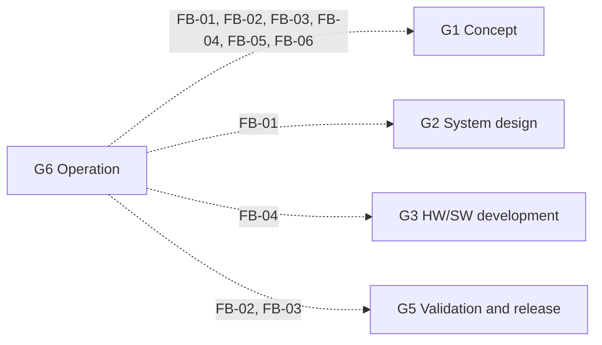

<!-- GENERATED by assurance/process/tools/process_model.py from assurance/process/model/. Do not edit; edit the model and re-run. -->

# Integrated lifecycle (L0)

One lifecycle with one gate per phase. All disciplines work inside each phase and decide at the same gate.
Gate names and exit criteria come from [WP-M-00 §2](../../01-management/WP-M-00-work-product-register.md#2-gates).

```mermaid
flowchart LR
  G0["G0 Governance<br/>21 activities modelled"]
  G1["G1 Concept<br/>12 activities modelled"]
  G2["G2 System design<br/>14 activities modelled"]
  G3["G3 HW/SW development<br/>19 activities modelled"]
  G4["G4 Integration and verification<br/>10 activities modelled"]
  G5["G5 Validation and release<br/>14 activities modelled"]
  G6["G6 Operation<br/>2 activities modelled"]
  G0 --> G1 --> G2 --> G3 --> G4 --> G5 --> G6
  classDef modelled fill:#0f6e63,stroke:#063f38,color:#ffffff
  classDef pending fill:#f6f8fa,stroke:#8c959f,color:#57606a,stroke-dasharray: 4 3
  class G0,G1,G2,G3,G4,G5,G6 modelled
```

## Feedback into earlier phases

Findings that a later phase routes back into work products of earlier phases (FB-nn, listed in the map of the phase that raises them). A finding that needs a change re-enters through problem resolution, change management and impact analysis.

## Phases

| Gate | Phase | Exit criterion (WP-M-00 §2) | Process map |
|---|---|---|---|
| G0 | Governance | Plans approved; roles assigned; configuration and change control running | [G0 map](g0-governance.md) |
| G1 | Concept | Machine limits, operating envelopes, risk assessment, safety functions with their required PL, risk reduction concept, cybersecurity and ML concepts approved; confirmation review of the risk assessment passed | [G1 map](g1-concept.md) |
| G2 | System design | Safety requirements specification, safety-related control architecture with categories and diagnostics, response-time and fall-arrest budget, mechanical and stability analysis and system-level analyses approved | [G2 map](g2-system-design.md) |
| G3 | HW/SW development | Safety-chain hardware and PL calculation, software requirements, architecture, units and unit verification approved for every safety-related part | [G3 map](g3-hw-sw-development.md) |
| G4 | Integration and verification | Hardware, software and system integration and PL verification complete; stability, fall, E-stop and detection tests passed; fault-injection campaign closed | [G4 map](g4-integration-and-verification.md) |
| G5 | Validation and release | Safety validation on the robot, cybersecurity validation, safety case, functional safety assessment and technical documentation complete; release record signed | [G5 map](g5-validation-and-release.md) |
| G6 | Operation | Field monitoring, incident response and update processes running | [G6 map](g6-operation.md) |
