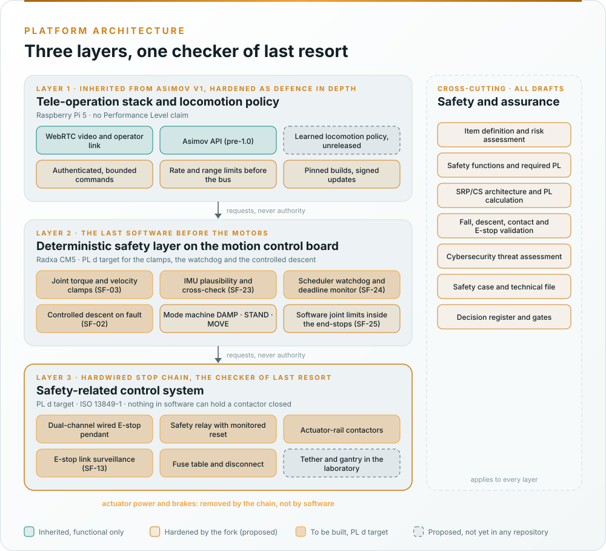

# Architecture

  

Asimov v1 inherits a shape a safety argument can use: a tele-operation stack on a Raspberry Pi 5 in the head (WebRTC
video, the Asimov API, in future a learned locomotion policy) in front of a motion control board on a Radxa CM5 that
talks to the 25 actuators over six CAN ports and is the last computer before the motors. The fork keeps that shape,
makes the motion control board carry a small deterministic safety layer, and adds a third layer below it: a hardwired
stop chain that removes actuator power without any software in the loop. A biped adds one thing a wheeled machine
does not have: removing power is itself a hazard, because a 35 kg body falls. The safe state was therefore a decision
(DQ-005, answered 2026-10-21): a controlled descent to a kneel or crouch, then power removal, with the emergency
stop removing power at once. Until that descent exists as verified firmware, the tether and gantry of the laboratory
envelope carry the fall.

| Layer | Role | Standard | Claim |
|---|---|---|---|
| Tele-operation stack and locomotion policy (Raspberry Pi 5) | Decides what to do: operator commands over the API, the policy's joint targets | Hardened as defence in depth; cybersecurity under IEC 62443; the policy under ISO/IEC TR 5469 and, if it becomes a safety component, the Machinery Regulation Annex I Part A | No Performance Level. Balance is not a safety function on the policy (DQ-006, decided 2026-10-21): the policy's commands are bounded by the safety layer and the tether carries a loss of balance |
| Deterministic safety layer (motion control board, Radxa CM5) | The last software before the motors: clamps joint torque and velocity (SF-03), checks IMU plausibility (SF-23), runs the watchdog and deadline monitor (SF-24), the mode machine and, once designed, the controlled descent (SF-02) | ISO 13849-1 §7 and §8 (software), Category 3 where single-fault tolerance is claimed | **PL d target** for SF-02, SF-03, SF-08, SF-23, SF-24 (DQ-004) |
| Hardwired stop chain | Dual-channel E-stop devices through a safety relay that drops the actuator-rail contactors; the BMS handshake interlock on CFG-002 | ISO 13849-1 categories, MTTFD, DCavg, CCF; IEC 60204-1; ISO 13850 | **PL d target** for the emergency stop and the E-stop link surveillance (SF-13); stop category 0, power removed at once (DQ-005) |
| Tether and gantry (OE-1 only) | Carries the robot's mass in a fall while no fall-arrest function exists | ISO 12100 §6.3 complementary protective measure | No PL; a condition of WP-V-07, recorded as claim G2.4 |

The argument is a doer-and-checker argument with one more step: the tele-operation stack and the policy propose,
the safety layer checks, and the stop chain is the checker of last resort that nothing in software can override. The
full strategy is
[WP-M-01 §6](../assurance/01-management/WP-M-01-assurance-strategy.md#6-safety-architecture-argument-the-central-strategy);
the architecture work products are [WP-S-03](../assurance/03-system/WP-S-03-technical-safety-concept.md) (the chain
and the safety layer), [WP-W-03](../assurance/05-software/WP-W-03-software-architecture.md) (the software) and
[WP-A-05](../assurance/08-analyses/WP-A-05-independence-of-the-safety-chain.md) (why the chain and the safety layer
are independent of the stack and the policy).

**Today none of the chain and none of the safety layer exists.** The kit robot as inherited has no documented E-stop,
no contactor, no fuse table, no disconnect and no firmware in any public repository; its only stop is whatever the
unreleased motion-control software does on heartbeat loss, which is to drop the robot. The first engineering act of
the fork is the bench equipment of [WP-V-07](../assurance/06-validation/WP-V-07-test-operations.md): a gantry, a
wired E-stop pendant and a bench supply.
