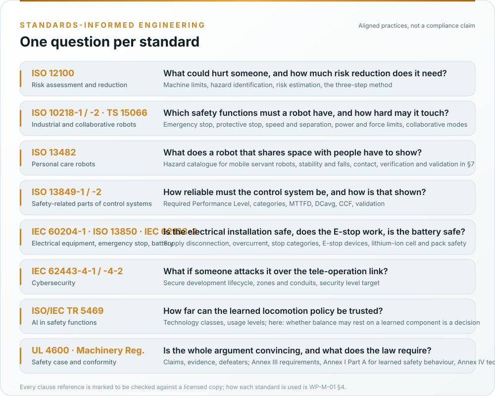

# How we use each standard

Asimov v1 is a machine and a robot that shares space with people, not a road vehicle. The standards are the
machinery set with the robot standards, applied with one method: one hazard log, one requirements database,
generated figures, a safety case with its defeaters published. This page says, for each standard, what the fork
takes from it, what it does not claim, and where it lands in the record. The authoritative version is
[WP-M-01 §4 and §5](../assurance/01-management/WP-M-01-assurance-strategy.md#4-the-standards-and-how-each-one-is-used).
**No compliance is claimed** with any of them, because no assessment has been performed and the drafting
environment has no licensed copy; every clause reference is marked to be checked.

*Which gate needs the work products that cite each standard is the [standards map](Standards-at-a-glance.md#where-each-standard-lands-in-the-lifecycle).*

## ISO 12100:2010, risk assessment and risk reduction

- **What we take:** the whole method. Machine limits (use, space, time), hazard identification per life phase on the
  Annex B catalogue, risk estimation and evaluation, then the three-step method in order: inherently safe design,
  safeguarding and complementary protective measures, information for use. The documentation of §7 becomes the heart
  of the technical file.
- **How:** [WP-C-01](../assurance/02-concept/WP-C-01-item-definition.md) defines the robot, its two configurations
  and its limits, [WP-C-03](../assurance/02-concept/WP-C-03-risk-assessment.md) is the one hazard log of the project
  (H-01…H-32, the fall of the robot first), and
  [WP-C-05](../assurance/02-concept/WP-C-05-risk-reduction-concept.md) allocates every hazard to the three steps.
- **Position taken:** a limitation that is only documented is not a control for a hazard that can kill; the tether
  and gantry of the laboratory are a complementary protective measure under §6.3 and are recorded as a claim of their
  own, not as a warning. The concept-phase package's "provisional acceptance" of the laboratory envelope becomes a
  proposal for the lead (DQ-002), not an acceptance.

## ISO 10218-1/-2:2025 and ISO/TS 15066:2016, industrial robots and collaborative operation

- **What we take:** the robot-system hazard list and the safety functions a robot must have (emergency stop,
  protective stop, speed and force limits, axis limits), and the body-region force, pressure and energy limits of
  collaborative operation for transient and quasi-static contact; ISO 13857 for reach and gap distances.
- **How:** [WP-C-04](../assurance/02-concept/WP-C-04-safety-functions-and-plr.md) specifies SF-01…SF-25 with their
  required Performance Level, among them SF-02 controlled descent, SF-03 the joint torque and velocity clamps,
  SF-04 force-limited contact, SF-13 the emergency stop and its link surveillance;
  [WP-C-06](../assurance/02-concept/WP-C-06-human-robot-interaction-and-misuse.md) carries the contact limits and the
  misuse analysis; [WP-V-03](../assurance/06-validation/WP-V-03-personnel-detection-validation.md) would measure them.
- **Position taken:** no contact is allowed in the first safety case. Nobody is within reach of a powered limb until
  the contact limits are measured; the collaborative functions are specified for the industrial envelope OE-2, which
  is excluded from the first item (DQ-002). Which editions to cite, the 2011 editions the package used or the 2025
  revisions, is a queued question (DQ-015).

## ISO 13482:2014, personal care robots

- **What we take:** the only hazard catalogue written for a robot that moves among people (Annex A: falls, contact,
  restraint, autonomous decisions, battery-powered emergencies), the requirements on stability and on forces and
  energies, and the verification and validation structure of §7.
- **How:** the catalogue feeds [WP-C-03](../assurance/02-concept/WP-C-03-risk-assessment.md);
  [WP-C-02](../assurance/02-concept/WP-C-02-operating-environment-and-tasks.md) defines the four operating envelopes
  OE-1 to OE-4 and rates each; [WP-V-02](../assurance/06-validation/WP-V-02-stopping-braking-stability-tests.md) is the
  stability, fall and controlled-descent test plan.
- **Position taken:** used as a hazard catalogue and a test structure, never as a conformity claim. A personal-care
  robot claim would need the home or public envelopes, which the record excludes; whether to widen the item is the
  lead's (DQ-002).

## ISO 13849-1:2023 and ISO 13849-2:2012, safety-related parts of control systems

- **What we take:** the Performance Level as the measure of a safety function, the risk graph for the required PL,
  the designated architectures (categories B to 4), MTTFD, DCavg and CCF, the software requirements of §7, the
  verification of §8, validation with the fault lists of 13849-2, and the documentation and information-for-use
  requirements.
- **How:** [WP-S-02](../assurance/03-system/WP-S-02-safety-requirements.md) (SRS),
  [WP-S-03](../assurance/03-system/WP-S-03-technical-safety-concept.md) (the stop chain and the safety layer, with
  categories), [WP-H-04](../assurance/04-hardware/WP-H-04-reliability-data-and-pl-calculation.md) (the PL calculation,
  with a SISTEMA project as the record), [WP-H-07](../assurance/04-hardware/WP-H-07-safety-component-qualification.md)
  (certified and well-tried components), [WP-V-01](../assurance/06-validation/WP-V-01-safety-validation.md) and
  [WP-V-05](../assurance/06-validation/WP-V-05-fault-injection.md) (validation and fault lists).
- **Position taken:** the stops that remove motor power are allocated to a **hardwired stop chain** alone (E-stop
  devices, safety relay, actuator-rail contactors, BMS interlock); the limits and monitors (clamps, IMU plausibility,
  watchdog, software joint limits) to a **deterministic safety layer** on the motion control board, developed under
  §7. Both carry a PL d target, pending the lead (DQ-004). The tele-operation stack and the learned policy are
  functional layers that are hardened but carry no PL claim. Twenty-five actuators of one type with no published
  failure rate (GAP-14) are the risk to this argument: the chain removes power upstream of them.

## IEC 62061:2021 and IEC 61508:2010, where ISO 13849 runs out

- **What we take:** management of functional safety (61508-1 §6), the functional safety assessment and its
  independence (61508-1 §8), software requirements beyond §7 of 13849-1 (61508-3) for the safety layer, and the
  tool classification T1 to T3.
- **How:** [WP-M-02](../assurance/01-management/WP-M-02-safety-plan.md), [WP-M-06](../assurance/01-management/WP-M-06-confirmation-measures-plan.md),
  [WP-P-07](../assurance/07-supporting/WP-P-07-tool-classification-qualification.md), the software work products.
- **Position taken:** no SIL claim is made. The target measure is the Performance Level; IEC 61508 supplies the
  management and assessment structure the machinery standards leave thin.

## IEC 60204-1:2018, ISO 13850:2015 and IEC 62133-2:2017, electrical equipment, the emergency stop and the battery

- **What we take:** the supply disconnecting device, overcurrent protection, protection against electric shock,
  protective bonding, control circuits and stop categories 0 and 1, the verification tests of §18; the emergency
  stop function and its devices; the safety of lithium cells and packs, with UN 38.3 for transport.
- **How:** [WP-H-05](../assurance/04-hardware/WP-H-05-electrical-safety.md),
  [WP-H-02](../assurance/04-hardware/WP-H-02-electrical-and-safety-chain-design.md),
  [WP-V-04](../assurance/06-validation/WP-V-04-emergency-stop-and-safety-chain-validation.md).
- **Position taken:** the first engineering act of the fork is bench equipment on any unit it tests with: a wired
  dual-channel E-stop pendant through a safety relay or contactors, a bench supply with a current limit in place of a
  battery, and a gantry ([WP-V-07](../assurance/06-validation/WP-V-07-test-operations.md); decisions DQ-007, DQ-008,
  DQ-009). The battery is treated as a policy, not a part: a certified-pack list with a BMS handshake interlock is the
  recommendation. The stop category of the emergency stop on a standing biped is a queued question (DQ-016).

## IEC 62443-4-1:2018 and IEC 62443-4-2:2019, cybersecurity

- **What we take:** the secure product development lifecycle practices (management, requirements, design,
  implementation, verification, defect management, update management, guidelines) and the component requirements
  with a security level target, plus the zone and conduit model of 62443-3-2/-3-3.
- **How:** [WP-M-08](../assurance/01-management/WP-M-08-cybersecurity-plan.md), the threat and risk assessment of the
  tele-operation channel and the API
  [WP-C-07](../assurance/02-concept/WP-C-07-cybersecurity-threat-and-risk-assessment.md), the requirements and
  security level target [WP-C-08](../assurance/02-concept/WP-C-08-cybersecurity-requirements-and-sl-target.md), the
  architecture [WP-S-07](../assurance/03-system/WP-S-07-cybersecurity-architecture.md), implementation and
  penetration testing, the cybersecurity case [WP-K-03](../assurance/10-safety-case/WP-K-03-cybersecurity-case.md).
- **Position taken:** threats that can cause a hazard are rated against the hazard list; the stop chain is a zone
  with no conduit from the tele-operation network, so no attack on the software can hold a contactor closed or
  command a joint past its clamp. Today the authentication of the tele-operation channel is undocumented and the
  wireless E-stop link and the debug port are unprotected (GAP-19, GAP-20); the security level target is the lead's
  (DQ-012).

## ISO/IEC TR 5469:2024 and the AI Act, machine learning in safety functions

- **What we take:** the classification of learned components by technology class and usage level, and the
  properties that would have to be shown if one implemented a safety function.
- **How:** [WP-M-09](../assurance/01-management/WP-M-09-ml-safety-plan.md),
  [WP-C-09](../assurance/02-concept/WP-C-09-ml-component-definition-and-safety-requirements.md),
  [WP-W-10](../assurance/05-software/WP-W-10-ml-engineering.md),
  [WP-K-07](../assurance/10-safety-case/WP-K-07-ai-act-conformity-record.md).
- **Position taken:** the question is live, because upstream allocates balance to a learned locomotion policy that
  nobody outside upstream has seen. Until the lead decides (DQ-006), no safety function is allocated to a learned
  component and stability in the laboratory is claimed only through the tether and gantry. That keeps the fork out of
  the Machinery Regulation's Annex I Part A (mandatory third-party assessment for self-evolving safety behaviour) and
  out of the AI Act's high-risk obligations; the threshold is monitored in WP-K-07.

## ISO 21448 (SOTIF), as a method only

- **What we take:** the vocabulary and method for hazards that happen without any fault: functional
  insufficiencies, triggering conditions, known and unknown scenarios. No machinery standard covers the performance
  limits of a learned balance controller or of monocular perception, and the package's worst rows (policy edge
  cases, DAMP as a hazard) are performance limits, not faults.
- **How:** [WP-C-10](../assurance/02-concept/WP-C-10-functional-insufficiency-analysis.md) and
  [WP-V-08](../assurance/06-validation/WP-V-08-unknown-scenarios-and-field-trials.md); every limit is closed by a
  safety function, an operating-envelope limit, or stays as an open defeater.
- **Position taken:** cited as informative. No SOTIF conformance is claimed or meaningful for a machine.

## UL 4600, the safety case

- **What we take:** the structure: claims, arguments, evidence with review state, defeaters published rather than
  hidden, assumptions stated, feedback from the field.
- **How:** [WP-K-01](../assurance/10-safety-case/WP-K-01-safety-case.md) is the document; the machine-readable
  records, validator and dashboard are in [`case/`](../assurance/case/README.md). GAP-01…GAP-34 are the first
  defeaters, all open.
- **Position taken:** no UL 4600 conformance claim; guidance only.

## Regulation (EU) 2023/1230, the Machinery Regulation, and Regulation (EU) 2024/1689, the AI Act

- **What we take:** the essential health and safety requirements (Annex III), the technical documentation
  (Annex IV), the conformity assessment procedures (Art. 25 and the modules), the manufacturer's obligations
  (Art. 10), the declaration of conformity (Annex V); Annex I Part A for self-evolving safety behaviour; and the AI
  Act's threshold for a high-risk AI system.
- **How:** [WP-M-13](../assurance/01-management/WP-M-13-regulatory-conformity-strategy.md) is the strategy,
  [WP-K-02](../assurance/10-safety-case/WP-K-02-technical-documentation-index.md) maps the register onto Annex IV,
  [WP-K-06](../assurance/10-safety-case/WP-K-06-release-record.md) holds the unsigned declaration draft.
- **Position taken:** the EU frame is recommended and open (DQ-001); internal control (Module A) with the harmonised
  standards applied in full is the recommendation for the laboratory robot, with EU type-examination mandatory if
  the policy becomes a safety component and worth considering once the robot is to stand free near people. Whoever
  assembles the kit makes the machine; the fork assigns no manufacturer and places nothing on the market. The US
  frame (ANSI/A3 R15.08, R15.06) is deferred and would be a cross-reference, not a second file.

## Automotive SPICE, process capability

- **What we take:** the process reference model for a self-assessment of process capability, because the gap
  assessment already rates upstream and the fork against it and no machinery-specific process model exists.
- **How:** [WP-M-12](../assurance/01-management/WP-M-12-process-capability-baseline.md), and the ASPICE column of the
  register.
- **Position taken:** a self-assessment, not an assessment; target CL2 for management, support, system and
  software processes, CL1 for hardware and ML. The package's ISO 9001 findings are closed through the quality plan.

## What is not applied, and why

[WP-M-00 §5](../assurance/01-management/WP-M-00-work-product-register.md) lists the standards the record holds not
applicable: ISO 3691-4, because a legged robot is not a driverless truck and its protective fields and braking
distances have no analogue here; ISO 26262, ISO/SAE 21434 and ISO/PAS 8800, because the robot is machinery and not
a road vehicle; ISO 14971, because it is not a medical device. The standard-agnostic method of those frameworks (one
hazard log, one requirements database, a living safety case) is kept.
