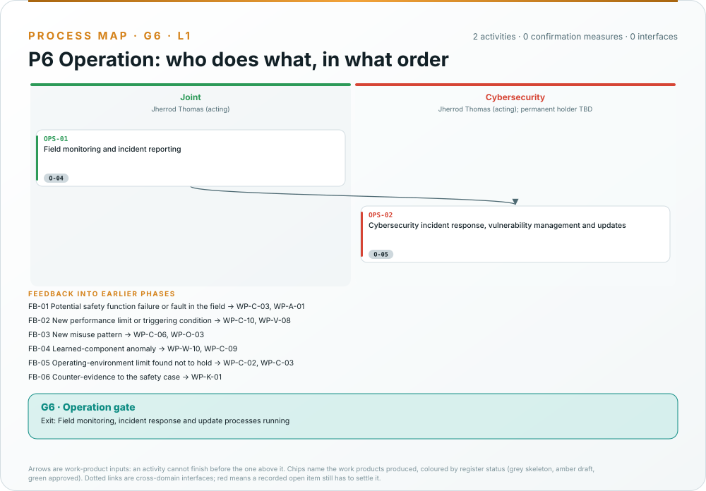

# Process maps

The integrated process model ([WP-P-11](../assurance/process/README.md)) records every phase as activities in
discipline lanes, linked by the work products they consume and produce, with the cross-domain interfaces where one
discipline's analysis depends on another's and the confirmation measures of the gate. Everything on this page is
drawn from that model by [`process_figures.py`](../assurance/process/tools/process_figures.py) and checked by CI,
so the swimlanes cannot disagree with the register, the safety plan or the confirmation plan. The same model also
generates a Mermaid map and an activity table per phase under [`maps/`](../assurance/process/maps/), linked from
each section below.

## The lifecycle (L0)

Read it row by row: the joint lane carries the governance phase almost alone, the machinery and robot risk
assessment lane peaks in the concept phase, the safety-related control lane dominates design and verification,
electrical, mechanical and software work sits in development, cybersecurity and machine learning run through every
phase, and the independent confirmation lane acts at every gate. The Mermaid version with the exit criteria is
[`maps/lifecycle.md`](../assurance/process/maps/lifecycle.md).

## How to read a swimlane

- **One column per discipline** present in the phase, with the role that owns it and who holds that role today,
  read from the [safety plan](../assurance/01-management/WP-M-02-safety-plan.md#31-role-assignments).
- **Top to bottom is dependency order.** An arrow is a work-product input: the activity at its head cannot finish
  before the one at its tail. Arrows implied by a longer path are left out; the activity table in the Mermaid map
  lists every input.
- **Chips name the work products produced**, coloured by their register status: grey skeleton, amber draft, green
  approved. The colour comes from [WP-M-00](../assurance/01-management/WP-M-00-work-product-register.md).
- **Dotted links are cross-domain interfaces**, anchored to text that occurs verbatim in both work products. Red
  means a recorded open item still has to settle it.
- **The yellow band** lists the confirmation measures the gate needs and whether a record exists; **the teal bar**
  is the gate and its exit criterion.

## G0 · Governance

What to look for: the impact analysis of the concept-phase package that the phase begins with; the plans and
procedures every later phase reads from; the roles still unassigned; whether the discipline plans and the safety
plan agree on who holds each role. Mermaid map and tables:
[g0-governance.md](../assurance/process/maps/g0-governance.md) · skeleton:
[G0](../assurance/10-safety-case/gates/skeletons/G0-skeleton.md).

## G1 · Concept

![Swimlane of the concept phase: the item definition feeds the operating envelopes, the interaction and contact analysis and the risk assessment; the risk assessment feeds the safety functions and their required PL, the risk reduction concept, the insufficiency analysis, the cybersecurity threat assessment and the test operations hold point; the ML lane defines the locomotion policy as a component outside every safety function; six confirmation measures at the gate; two open interfaces, the safe state of the biped and the allocation of balance.](../docs/assets/asimov/process/g1.svg)

What to look for: the risk-assessment lane carrying most of the phase and feeding the control-system lane; the two
open interfaces, the safe state of the biped and whether the learned policy may carry balance, which wait on
decisions by the lead; the test operations hold point whose bench equipment is needed before the first hang test;
six confirmation measures, none performed. Mermaid map and tables:
[g1-concept.md](../assurance/process/maps/g1-concept.md) · skeleton:
[G1](../assurance/10-safety-case/gates/skeletons/G1-skeleton.md).

## G2 · System design

What to look for: the serial chain from the requirements specification to the independence analysis, all in one
lane; the structural and stability analysis that bounds the fall energy the budget depends on, in a lane with no
owner yet; the safety and security interface in the architecture, where the stop chain must be a zone with no network
conduit. Mermaid map and tables: [g2-system-design.md](../assurance/process/maps/g2-system-design.md) · skeleton:
[G2](../assurance/10-safety-case/gates/skeletons/G2-skeleton.md).

## G3 · Hardware and software development

What to look for: the PL calculation waiting on fault lists, component data that upstream has not published, and
the common-cause score; a safety layer written from nothing, since no firmware exists in any public repository; the
safety-parameter integrity interface between software and cybersecurity. Mermaid map and tables:
[g3-hw-sw-development.md](../assurance/process/maps/g3-hw-sw-development.md)
· skeleton: [G3](../assurance/10-safety-case/gates/skeletons/G3-skeleton.md).

## G4 · Integration and verification

What to look for: a phase that cannot start without a bench and a gantry whose owner is unassigned; every powered
test under the hold point of [WP-V-07](../assurance/06-validation/WP-V-07-test-operations.md); the fall and descent
tests before anyone comes within reach. Mermaid map and tables:
[g4-integration-and-verification.md](../assurance/process/maps/g4-integration-and-verification.md) · skeleton:
[G4](../assurance/10-safety-case/gates/skeletons/G4-skeleton.md).

## G5 · Validation and release

What to look for: the three arguments meeting once, in the safety case; the assessments in the independent lane,
by parties nobody has engaged; the technical documentation shared between the Machinery Regulation and, if the
policy ever becomes a safety component, the AI Act. Mermaid map and tables:
[g5-validation-and-release.md](../assurance/process/maps/g5-validation-and-release.md) · skeleton:
[G5](../assurance/10-safety-case/gates/skeletons/G5-skeleton.md).

## G6 · Operation

What to look for: the six feedback routes back into the concept phase, each anchored to the routing table of
[field monitoring](../assurance/09-production-operation/WP-O-04-field-monitoring.md); and that the same path is
already needed from the first hang test, five gates before it is gated. Mermaid map and tables:
[g6-operation.md](../assurance/process/maps/g6-operation.md) · skeleton:
[G6](../assurance/10-safety-case/gates/skeletons/G6-skeleton.md).

## Cross-domain interfaces

An interface is a point where one discipline's analysis depends on another's: safety and security, safety and the
performance limits of the policy, control and mechanical, software and hardware, regulatory and machine learning.
Each is anchored to a sentence that occurs verbatim in both work products; the checker fails if either sentence
disappears. *Documented* means the documents reference each other but nobody has reviewed the agreement yet.

## Gate skeletons

For each gate the model also generates a pre-filled gate review skeleton in
[`10-safety-case/gates/skeletons/`](../assurance/10-safety-case/gates/skeletons/): the gate's work products with their
status and open-item counts, the confirmation measures and whether their records exist, the open interfaces, the
unassigned roles and the exit criteria as rows to fill. A skeleton is not a gate review; holding one means copying it
to a dated file and re-checking every value at the review baseline ([gates README](../assurance/10-safety-case/gates/README.md)).

## Changing the model

The model is data in [`assurance/process/model/`](../assurance/process/model/): phases, lanes, activities, reviews,
interfaces and feedback routes in a flat YAML subset. Edit the records, run
`python3 assurance/process/tools/process_model.py` and `python3 assurance/process/tools/process_figures.py`, and
commit the records with the regenerated maps, skeletons and figures. The checkers (`--check`) fail in CI when a map
or figure is stale, an anchor disappears from a work product, a work product the register gates in a phase has no
producing activity, or the gate's confirmation measures differ from
[WP-M-06 §9](../assurance/01-management/WP-M-06-confirmation-measures-plan.md#9-schedule-summary).
