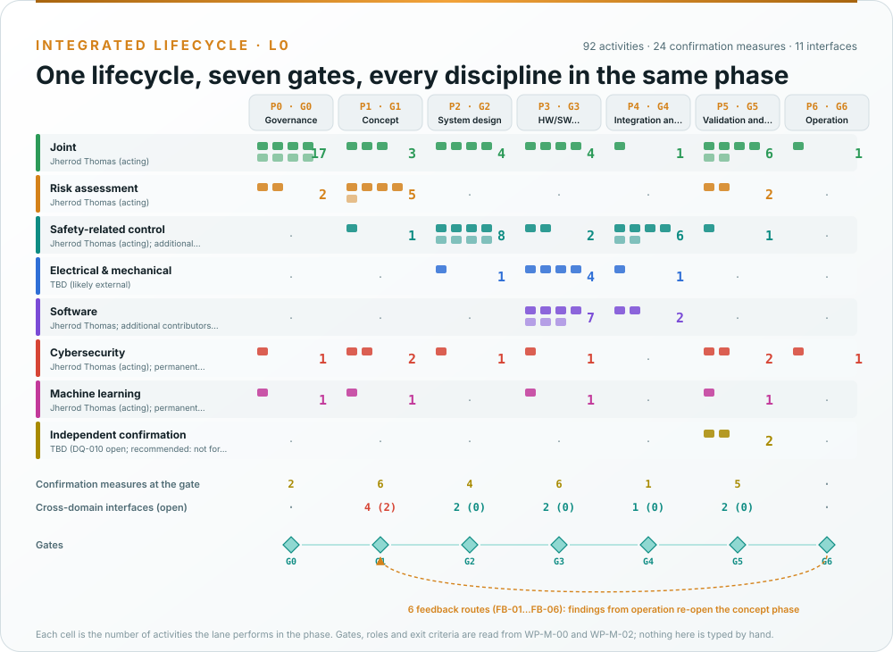
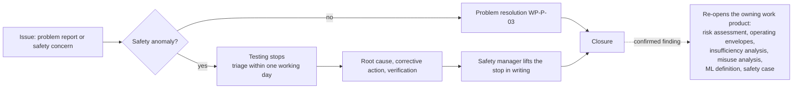

# Processes

How the work is done: one lifecycle with seven gates, the activities each discipline performs inside each phase,
and the supporting processes every change passes through. This page is the plain-language version; the authoritative
records are the [safety plan, WP-M-02](../assurance/01-management/WP-M-02-safety-plan.md), the
[integrated process model, WP-P-11](../assurance/process/README.md) and the supporting work products of
[`07-supporting/`](../assurance/07-supporting/README.md). The generated swimlane maps are on
[Process maps](Process-maps.md).

## One lifecycle, seven gates

Every discipline (machinery and robot risk assessment, safety-related control system, electrical and mechanical,
software, cybersecurity, machine learning) works inside the same phase and decides at the same gate. There is no
separate cybersecurity lifecycle or ML lifecycle running beside the safety one, even though the learned locomotion
policy is where the two meet.

*Drawn from the process model by [`process_figures.py`](../assurance/process/tools/process_figures.py); the
swimlane of every phase is on [Process maps](Process-maps.md). What each phase contains:*

```mermaid
flowchart LR
  P0[P0 Governance<br/>plans, roles, configuration control,<br/>the concept package reconciled] --> G0{{G0}}
  G0 --> P1[P1 Concept<br/>robot limits, envelopes, risk assessment,<br/>safety functions and PLr, safe state] --> G1{{G1}}
  G1 --> P2[P2 System design<br/>SRS, stop chain and safety layer,<br/>fall-arrest budget, analyses] --> G2{{G2}}
  G2 --> P3[P3 HW/SW development<br/>chain hardware, PL calculation,<br/>the safety layer] --> G3{{G3}}
  G3 --> P4[P4 Integration and verification<br/>bench, fall and descent tests on the gantry,<br/>contact, E-stop, fault injection] --> G4{{G4}}
  G4 --> P5[P5 Validation and release<br/>validation on the robot, assessment,<br/>technical file] --> G5{{G5}}
  G5 --> P6[P6 Operation<br/>field monitoring, incident response] --> G6{{G6}}
  P6 -. findings re-open P1 work products .-> P1
```

| Gate | What must be true to pass |
|---|---|
| G0 Governance | Plans approved; roles assigned; configuration and change control running |
| G1 Concept | Machine limits, operating envelopes, risk assessment, safety functions with their required PL, risk reduction concept, cybersecurity and ML concepts approved; confirmation review of the risk assessment passed |
| G2 System design | Safety requirements specification, safety-related control architecture with categories and diagnostics, response-time and fall-arrest budget, mechanical and stability analysis and system analyses approved |
| G3 HW/SW development | Chain hardware and PL calculation, software requirements, architecture, units and unit verification approved |
| G4 Integration and verification | Integration and PL verification complete; stability, fall, E-stop and detection tests passed; fault injection closed |
| G5 Validation and release | Validation on the robot, cybersecurity validation, safety case, assessment and technical documentation complete; release record signed |
| G6 Operation | Field monitoring, incident response and update processes running |

The exit criteria are owned by [WP-M-00 §2](../assurance/01-management/WP-M-00-work-product-register.md#2-gates). A
gate review follows [WP-M-02 §10](../assurance/01-management/WP-M-02-safety-plan.md#10-progress-tracking-and-gate-reviews),
and a pre-filled skeleton per gate is generated by the process model into
[`10-safety-case/gates/skeletons/`](../assurance/10-safety-case/gates/skeletons/). No gate has been held.

## Two hold points

- **Before any powered test with the feet on the floor** (G1): a gantry and a tether rated for the robot's mass
  under a dynamic load, a wired dual-channel E-stop pendant in the operator's hand that removes the actuator rail, a
  bench supply with a current limit in place of a battery, known joint limits, an identified controller build, the
  robot weighed, the area marked and empty, and the operator trained and through the pre-session checks.
  [WP-V-07](../assurance/06-validation/WP-V-07-test-operations.md) is the procedure. Until the gantry and the pendant
  exist, everything on the kit robot is bench work with single limbs or the robot hanging with its feet off the floor.
- **Before any person comes within reach of a powered limb** (G4): the contact limits and the speed reduction have
  passed [WP-V-03](../assurance/06-validation/WP-V-03-personnel-detection-validation.md).

## Inside a phase: activities in lanes

The process model records each phase as activities in discipline lanes, linked by the work products they consume
and produce, with explicit cross-domain interfaces where one discipline's result depends on another's.

*The concept phase: the risk-assessment lane produces the hazard list, the control-system lane derives the safety
functions and their required PL from it, cybersecurity rates its threats against the same hazards, and the ML lane
defines the locomotion policy as a component outside every safety function. The two open interfaces are the safe
state of the biped and whether the policy may carry balance, both waiting on decisions by the lead. The other six
phases are on [Process maps](Process-maps.md).*

## What a change goes through

*Rendered from the [safety-relevant file list](../assurance/07-supporting/safety-relevant-paths.txt) and the [workflow files](../.github/workflows) at every wiki sync.*

1. **Classify.** The paths a change touches put it in class SR-A (the stop chain, power distribution, the motion
   control board, the harness, the safety layer, safety parameters), SR-Q (the structure, the simulation model, the
   API and the policy), SR-T (build, CI, pins) or NSR ([WP-P-01](../assurance/07-supporting/WP-P-01-configuration-management-plan.md)).
2. **Analyse the impact.** A safety-relevant change names the hazards, safety functions, requirements and
   assumptions it touches, in a record under [`07-supporting/impact/`](../assurance/07-supporting/impact/README.md)
   ([WP-P-02](../assurance/07-supporting/WP-P-02-change-management.md), [WP-M-11](../assurance/01-management/WP-M-11-impact-analysis.md)).
3. **Verify.** Tests, analyses, generators re-run; CI checks the case records, the register, the process model, the
   figures, the links and the tables on every pull request.
4. **Review.** A person other than the author reviews at the independence level
   [WP-P-05](../assurance/07-supporting/WP-P-05-verification-review-procedure.md) requires; two approvals on SR-A paths.
5. **Record.** The affected work products change in the same pull request; nothing moves past Draft without a
   review record.

## Review and independence

| Level | Meaning | Who can do it today |
|---|---|---|
| I0 | May be done by the author | The maintainer |
| I1 | A person other than the author | Nobody yet: the verification reviewer role is open |
| I2 | Independent of the team | An external reviewer |
| I3 | Independent of the organisation | An external assessor |

Verification reviews (per pull request) check a work product against its inputs. Confirmation measures check that
the work product, the process and the result meet the standards: confirmation reviews CR-01…CR-12, functional safety
audits AUD-1 and AUD-2, interim and final functional safety assessments, a cybersecurity review and assessment, ML
reviews of the position on the policy, and, depending on the conformity route, a notified body's type-examination.
Which is due at which gate is
[WP-M-06 §9](../assurance/01-management/WP-M-06-confirmation-measures-plan.md#9-schedule-summary). None has been
performed; no assessor is engaged.

## Problems, anomalies and field findings

A safety anomaly is anything that could violate a safety function, an operating limit or an assumption of the risk
assessment: an uncommanded motion, a fall or a near-fall, a contact with a person, a stop that did not happen or was
late, a tether that took load. It stops testing ([WP-M-02 §9](../assurance/01-management/WP-M-02-safety-plan.md#9-safety-anomaly-handling),
[WP-V-07 §6](../assurance/06-validation/WP-V-07-test-operations.md#6-anomalies)). In operation, the same path is
[field monitoring](../assurance/09-production-operation/WP-O-04-field-monitoring.md), whose routing table sends each
kind of finding back to the work product that owns it; the process model draws those routes as feedback into the
concept phase ([G6 map](../assurance/process/maps/g6-operation.md)).

## Decisions

Questions only the project lead can answer (risk acceptance, required PL, the safe state of the biped, robot
behaviour defaults, operating-envelope limits, money, hardware, the assessor, roles, gate go/no-go) go into the
decision register as self-contained questions, in batches of ten. See [How decisions are made](How-decisions-are-made.md).

## Release

A release is a tagged commit of this repository, pins of the firmware, API and policy once they are published, a
parameter set and a documentation state ([WP-P-10](../assurance/07-supporting/WP-P-10-release-management.md)). It
needs gate G5: validation on the robot, the assessment report, the technical documentation of the Machinery
Regulation and an unsigned declaration draft ([WP-K-06](../assurance/10-safety-case/WP-K-06-release-record.md)). The
fork publishes no release yet.
