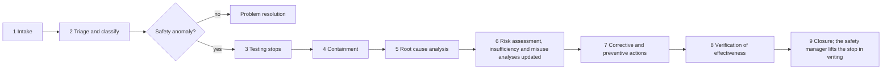

# Reporting a safety concern

Three routes, depending on what you found. If you are unsure which one applies, report anyway and say so; the
safety manager will route it.

| What you found | Where it goes | Why |
|---|---|---|
| A security vulnerability | **Privately**, through [GitHub private vulnerability reporting](https://github.com/jherrodthomas/asimov-v1/security/advisories/new). Never a public issue, pull request or discussion. | A vulnerability in the robot's software can move a 35 kg machine around people, defeat a stop or drop the robot. [SECURITY.md](../SECURITY.md) has the full policy. |
| A hazard the analyses may miss, a near miss, a fall, contact, injury or damage | A GitHub issue with the **Safety concern** template | It enters the problem resolution and field monitoring path ([WP-P-03](../assurance/07-supporting/WP-P-03-problem-resolution.md), [WP-O-04](../assurance/09-production-operation/WP-O-04-field-monitoring.md)). |
| A defect, a test anomaly, or a doubt about an analysis | A GitHub issue with the **Problem report** template | Everything else. |

## What to include

- The configuration and baseline: CFG-001 tethered and bench-powered or CFG-002 with a battery and the policy, and
  which commit of this repository; the firmware or controller build if one was running.
- The envelope, the task, the mode (DAMP, STAND, MOVE), the joint limits in force and who was where, if an event.
- Facts first, conclusions after; logs, the test log entry, photos, the tether configuration and whether it took
  load, the bench supply settings.
- Which work product and section you think is affected, if a finding against the analyses.

If you are unsure, report anyway. A near miss in a scenario that can kill is a class A anomaly even when nothing
happened this time.

## What happens next

A safety anomaly is anything that could violate a safety function, an operating limit or an assumption of the risk
assessment: an uncommanded motion, a fall or a near-fall, a contact with a person or object, a stop that did not
happen or was late, a tether load that was not planned, a failed pre-session check, an E-stop press that was not
planned. It is raised as an issue labelled `safety-anomaly`, and triage happens within one working day
([WP-M-02 §9](../assurance/01-management/WP-M-02-safety-plan.md#9-safety-anomaly-handling)). Testing stops until the
safety manager lifts the stop ([WP-V-07 §6](../assurance/06-validation/WP-V-07-test-operations.md#6-anomalies)).

The severity class is based on the worst credible outcome, not the outcome observed; the classes and the root
cause categories are defined in [WP-P-03](../assurance/07-supporting/WP-P-03-problem-resolution.md). Class A and B
anomalies cannot close without a review by someone other than the analyst. A confirmed finding is routed back to
the work product that owns it by the table in
[WP-O-04](../assurance/09-production-operation/WP-O-04-field-monitoring.md): the risk assessment, the operating
envelopes, the insufficiency analysis, the misuse analysis, the ML definition or the safety case.

## Rules for anyone testing

No Asimov v1 unit is powered with its feet on the floor under the fork's control until the conditions of
[WP-V-07](../assurance/06-validation/WP-V-07-test-operations.md) hold: the gantry and tether are rated and inspected,
the wired E-stop pendant is tested before every session, a bench supply replaces the battery, the area is marked and
empty, the operator has a hand on the pendant and an observer is present. Nobody is within reach of a powered limb,
and the robot never stands free of its tether. Test only on equipment you own or are authorised to test, and never
against upstream or third-party infrastructure.
