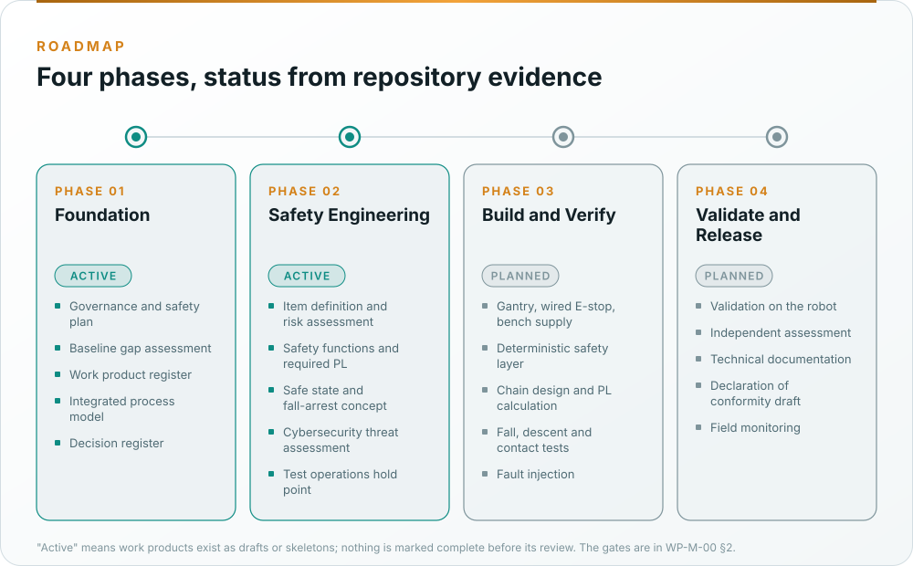

# Roadmap and status

Four phases. Status is taken from what exists in the repository: "draft" means written but not reviewed,
"skeleton" means the structure and clause map exist, and nothing is called complete before its review. This table
mirrors the [record roadmap in the README](../README.md#record-roadmap); a status changes here only when the owning
work product changes its document-control header.

| Phase | State |
|---|---|
| 1 · Foundation | Active |
| 2 · Safety engineering | Active |
| 3 · Build and verify | Planned |
| 4 · Validate and release | Planned |

## Where each phase stands

| Phase | Work | Status |
|---|---|---|
| **1 · Foundation** | [Assurance strategy](../assurance/01-management/WP-M-01-assurance-strategy.md), [safety plan](../assurance/01-management/WP-M-02-safety-plan.md), [confirmation measures](../assurance/01-management/WP-M-06-confirmation-measures-plan.md), [regulatory strategy](../assurance/01-management/WP-M-13-regulatory-conformity-strategy.md) | Draft |
| | [Baseline gap assessment](../assurance/00-assessment/gap-assessment.md) of the inherited repository and the [concept-phase package](../assurance/00-assessment/concept-package/README.md) | Draft |
| | [Work product register](../assurance/01-management/WP-M-00-work-product-register.md), [process model](../assurance/process/README.md), [decision register](../assurance/01-management/decisions/README.md) | Draft; checked by CI |
| | Project plan, QA plan, risk register, cybersecurity and ML plans, upstream management, impact analysis, capability baseline | Skeleton |
| | [Living Safety Case records and dashboard](../assurance/case/README.md) | Draft: records at BL-001, seeded from the package, validated and drawn by CI |
| **2 · Safety engineering** | [Item definition](../assurance/02-concept/WP-C-01-item-definition.md), [operating envelopes](../assurance/02-concept/WP-C-02-operating-environment-and-tasks.md), [risk assessment](../assurance/02-concept/WP-C-03-risk-assessment.md), [safety functions and PLr](../assurance/02-concept/WP-C-04-safety-functions-and-plr.md) | Draft, ported from the concept package; the required PL and the envelope wait on the lead (DQ-002, DQ-004) |
| | [Risk reduction concept](../assurance/02-concept/WP-C-05-risk-reduction-concept.md), [human-robot interaction, contact limits and misuse](../assurance/02-concept/WP-C-06-human-robot-interaction-and-misuse.md) | Skeleton; the safe state (DQ-005) and the tether as complementary measure (DQ-007) shape them |
| | [Insufficiency analysis](../assurance/02-concept/WP-C-10-functional-insufficiency-analysis.md), [cybersecurity threat assessment](../assurance/02-concept/WP-C-07-cybersecurity-threat-and-risk-assessment.md), [ML component definition](../assurance/02-concept/WP-C-09-ml-component-definition-and-safety-requirements.md) | Skeleton |
| | [Test operations hold point](../assurance/06-validation/WP-V-07-test-operations.md) | Draft; the gantry, the wired E-stop and the bench supply wait on the lead (DQ-007, DQ-008, DQ-009) |
| **3 · Build and verify** | Bench equipment, the [safety layer](../assurance/05-software/WP-W-03-software-architecture.md), [stop-chain architecture](../assurance/03-system/WP-S-03-technical-safety-concept.md), [fall-arrest budget](../assurance/03-system/WP-S-04-response-time-and-stopping-budget.md) and [PL calculation](../assurance/04-hardware/WP-H-04-reliability-data-and-pl-calculation.md), [fall and descent tests](../assurance/06-validation/WP-V-02-stopping-braking-stability-tests.md), [fault injection](../assurance/06-validation/WP-V-05-fault-injection.md) | Planned |
| **4 · Validate and release** | [Safety validation](../assurance/06-validation/WP-V-01-safety-validation.md), [assessment](../assurance/10-safety-case/WP-K-04-functional-safety-assessment.md), [technical documentation](../assurance/10-safety-case/WP-K-02-technical-documentation-index.md), [release record](../assurance/10-safety-case/WP-K-06-release-record.md), [field monitoring](../assurance/09-production-operation/WP-O-04-field-monitoring.md) | Planned |

## What the next gate needs

G0 needs the plans approved, the roles assigned and configuration control running. Today every plan is a draft or
a skeleton; the verification reviewer, QA, electrical and mechanical engineer and test bench owner roles are open;
and the firmware, API and policy are not published, so there is nothing to pin. The generated
[G0 readiness section](../assurance/process/maps/g0-governance.md#5-g0-readiness) lists what is missing, and the
[G0 gate skeleton](../assurance/10-safety-case/gates/skeletons/G0-skeleton.md) is the pre-filled review record. The
questions that wait on the project lead are in the [decision register](How-decisions-are-made.md); the two that
shape everything below G0 are the regulatory frame and the first operating envelope, and the two that shape the
concept phase are the safe state of the biped and whether the learned policy may carry balance.

## Sources

- [README, Record roadmap](../README.md#record-roadmap)
- [WP-M-00 work product register](../assurance/01-management/WP-M-00-work-product-register.md): every work product, its gate and status
- [WP-M-01 §7](../assurance/01-management/WP-M-01-assurance-strategy.md#7-phases-gates-and-sequence): phases, gates and hold points
